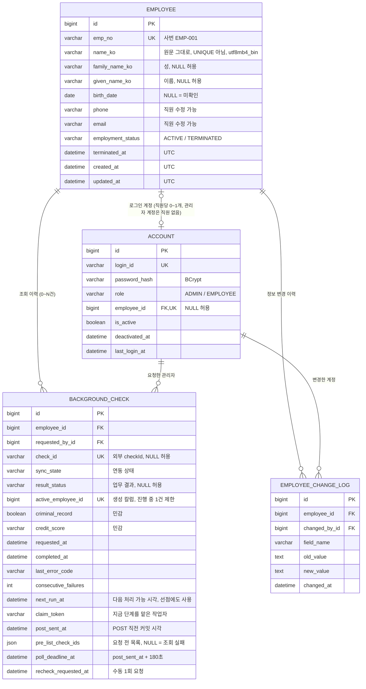
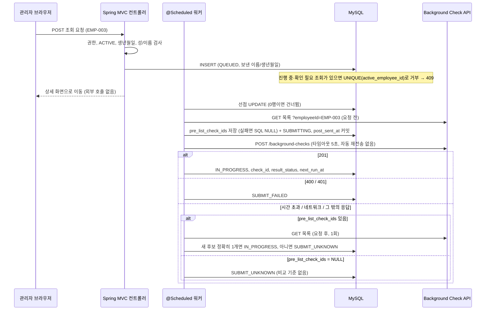
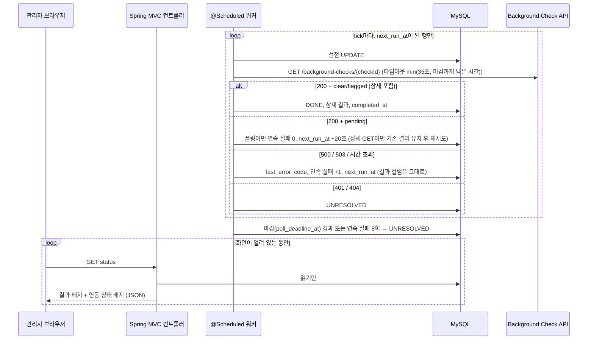

# DESIGN — 사내 직원 관리 시스템 구현 전 설계안 (검토용)

> 이 문서는 구현 전에 검토하기 위한 설계안이다. 아직 앱 코드, DB 테이블, 마이그레이션 파일은 없다. 이 문서의 SQL과 Java 코드 조각은 설계 설명용이다.
> 표시 규칙: **[확인]** 저장소나 이 PC에서 직접 확인한 사실 · **[실측]** `measurement/MEASUREMENTS.md`에 적힌 수치(n 포함) · **[제안]** 이 문서의 설계 판단 · **[미정]** 아직 모르거나 나중에 정할 것 · **[과거 설계]** 지금은 쓰지 않는 이전 안을 설명하는 문맥
> 설계 선택마다 붙은 "← 요구사항"은 과제 설명서(`InterviewTasks.txt`)나 MEASUREMENTS.md 11장의 어느 요구 때문에 그 선택이 필요한지를 적은 것이다.

> **변경 요약 (3차 개정: Java + Spring Boot + Spring Security + MySQL 전환)**
> 앱 기술을 지원자가 익숙한 **Java 17 + Spring Boot + Spring Security + MySQL 8.0**과 **IntelliJ IDEA**로 바꿨다. Python 측정 도구, CSV, MEASUREMENTS.md의 실측 수치와 11장 정책값, 시드 직원 10명은 그대로 둔다. 기술 이름만 바꾸지 않고, 선택한 기술에서 실제로 동작하도록 다음 설계를 고쳤다.
> 1. **퇴사자 세션 차단**: Spring Security는 로그인 후 세션에 저장한 사용자 정보를 요청마다 DB에서 다시 읽지 않는다. 그래서 요청마다 계정 상태를 DB에서 확인하는 필터 1개를 추가했다(2.4, 5.1, 6.1).
> 2. **진행 중 1건 제한**: MySQL에는 조건부(부분) UNIQUE 인덱스가 없다. 그래서 "진행 중일 때만 직원 ID를 담는 생성 칼럼 + UNIQUE"로 바꿨다(4.3).
> 3. **MySQL 자료형 규칙**: 시간대가 있는 시각 타입이 없어 `DATETIME(6)` + "항상 UTC" 규칙을 두었다. DB 시계는 `UTC_TIMESTAMP(6)`만 쓴다. `JSONB` → `JSON`, `UUID` → `VARCHAR(36)`으로 바꿨다. 문자열 연결은 `CONCAT()`을 쓴다(MySQL에서 `||`는 OR다). 이름 비교는 `utf8mb4_bin`으로 한다(4장).
> 4. **비동기 처리**: 폴링 루프를 Spring `@Scheduled` 작업 1개로 구현한다. 선점 SQL은 MySQL 문법(`RETURNING` 없음 → 영향받은 행 수로 판단)으로 바꿨다. 선점 원자성은 실제 MySQL에서 동시 테스트로 검증한다(2.5).
> 5. **마이그레이션과 시드**: Flyway SQL 파일로 테이블과 시드 10명을 만든다. 계정 비밀번호만 환경변수로 받아 시작 시 만든다(4장, 7장).
> 6. **IntelliJ Community + 로컬 MySQL** 실행 방법과 구현 전 위험 목록을 부록 A·B로 추가했다.
>
> **[과거 설계] 이전 개정 이력**(Python/Django + PostgreSQL 전제)
> - 1차: 실측 수치 갱신, `SUBMIT_UNKNOWN`·`UNRESOLVED` 상태 도입, 8.3장을 11장 결정값 표로 교체
> - 2차: "조회 1건당 스레드 + 임대 컬럼"을 버리고 "DB 행 + 짧은 단계 + 루프 1개 + 조건부 UPDATE 선점"으로 교체. 요청 전후 목록 비교 규칙을 도입하고, 상세 GET과 pending 폴링을 구분
> - 2차에서 정한 **동작 규칙(상태, 전후 비교, 상세 GET 해석)은 그대로 유지**하고, 이번에는 구현 수단만 Java/MySQL에 맞게 바꿨다.

---

## 1. 현재 저장소에서 확인한 사실과 아직 모르는 것

### 1.1 확인한 사실

| 구분 | 내용 |
|---|---|
| 파일 구성 [확인] | `InterviewTasks.txt`, `swagger.yaml`, `DESIGN.md`, `measurement/`(측정 스크립트 `measure_background_api.py`, `requirements.txt`, `README_MEASUREMENT.md`, `MEASUREMENTS.md`, `data/*.csv`)만 있다. |
| 앱 코드 [확인] | **없음.** Java 소스, `build.gradle`/`pom.xml`, 마이그레이션, 템플릿이 없다. |
| 배포 계획 [확인] | **없음.** Dockerfile, CI 설정, 클라우드 설정 파일이 없다. |
| 버전 관리 [확인] | git 저장소가 아니다. 제출물 1이 소스 저장소 링크를 요구하므로 `git init`부터 한다. |
| 측정 도구 [확인] | **Python 3.12.10 + requests + PyYAML**(`runs.csv`)이다. 앱과 분리된 도구이며 **수정하지 않는다.** |
| 앱 기술 [확인] | 지원자가 **Java + Spring Boot + Spring Security + MySQL, IntelliJ IDEA**로 정했다. |
| 이 PC의 개발 도구 [확인] | JDK **Temurin 17.0.16**(`java -version`), **MySQL Community Server 8.0.39**(서비스 이름 `MySQL`, 실행 중. `mysql.exe`는 `C:\Program Files\MySQL\MySQL Server 8.0\bin`에 있고 PATH에는 없음), **MySQL Workbench 8.0**, **IntelliJ IDEA Community Edition 2024.1.4**. Docker는 없다. `~/.gradle`, `~/.m2` 캐시가 있다. |
| 인증키 취급 [확인] | 측정 도구는 `CANDIDATE_KEY` 환경변수로만 키를 받는다. `.gitignore`가 `.env`와 `*.key`를 제외한다. 앱도 같은 원칙을 따른다. |
| MEASUREMENTS.md [확인] | 2026-09-22T15:42Z 생성본으로, 자동 측정 HTTP 요청 549건과 lifecycle 31건을 담고 있다. **11장(최종 결정)은 지원자가 기입했다.** 이 문서는 그 값을 인용만 하고 새 값을 만들지 않는다(8.3절). |
| 측정 도구의 이름 분리 [확인] | `split_korean_name`은 복성 목록(남궁·황보·선우·제갈 등 8개)에 있으면 앞 두 글자를, 아니면 첫 글자를 성으로 자른다. 이 규칙으로는 선우진이 항상 `선우/진`이 된다. 앱은 같은 규칙을 **초깃값 제안**으로만 쓰고, 결과는 데이터로 저장한다(7장). |

### 1.2 실측 결과 중 데이터 구조에 영향을 주는 사실

이 표의 실측값은 타임아웃이나 주기 값을 정하는 데 쓰지 않는다. 상태나 컬럼이 **필요한지** 판단하는 데만 쓴다.

| 실측 사실 [실측] | 설계에 주는 영향 |
|---|---|
| `dateOfBirth` 누락과 빈 문자열 모두 **400** (`Missing required field: dateOfBirth`, 각 n=1, 7.5절) | EMP-007은 외부 API에 보낼 수 없다. 서버가 요청 전에 막고 "생년월일 미확인" 상태로 보여 줘야 한다. |
| 같은 employeeId로 POST 5회 → **서로 다른 checkId 5개** (n=5, 4장) | 외부 API가 중복을 막아 주지 않는다. 우리 DB가 "진행 중인 조회"를 한 건으로 제한하고, POST는 자동으로 재시도하지 않는다. |
| 순차 GET의 **59.1%가 일시적 실패**(500 142건, 503 97건, 타임아웃 5건 / 413건, 8.1절) | "조회 실패"와 "업무 결과(pending/clear/flagged)"를 **별도 컬럼**으로 둔다. 실패한 GET이 결과를 덮어쓰면 안 된다. |
| HTTP 200 GET 지연 p95 26,636ms, max 29,776ms (n=203, 2장). 약 30초 걸리는 503 44건(8.0장) | 화면 요청 안에서 외부 결과를 기다리지 않는다. 외부 호출은 서버의 예약 작업(`@Scheduled` 워커)이 하고, 화면은 DB에 저장된 상태만 읽는다(2.5, 6.4). |
| POST 201 응답 필드는 `checkId, createdAt, employeeId, message, status`뿐 (`measurements.csv` responseFields) | POST에서 즉시 `clear`를 받아도 상세 결과(범죄기록 등)는 **상세 GET**으로 한 번 더 가져와야 한다. 이 GET은 pending을 기다리는 폴링과 다르다(6.4). |
| 정상 입력 POST **36건 모두 201**, 지연 max 1,895ms (n=36, 2.4·3.2장). 400 4건은 오류 케이스 시험에서 일부러 보낸 요청이다(7.5장). POST 5xx·시간 초과는 관측되지 않음 | POST 시간 초과는 드물게 일어날 예외 경로다. 요청 전 목록 조회에 실패해도 POST를 막지 않는다(4.3). |
| `estimatedCompletionSeconds` **관찰 0 / 36** (7.3절) | 이 필드에 의존하는 컬럼이나 로직을 만들지 않는다. |
| 503의 `Retry-After` **헤더 0 / 116**, body `retryAfter` 72 / 116 (8장) | 다음 처리 가능 시각(`next_run_at`)을 저장할 컬럼이 필요하다. 11장 규칙대로 헤더 → body → 기본 간격 순으로 읽는다. |
| GET 목록(`?employeeId=`)은 자동 측정 9건 중 **200이 1건**(나머지 400·500·503·타임아웃, 7.1절). 11장은 이를 "7회 중 1회만 200(표본 적음)"으로 정리했다 | 조회 이력은 외부 목록 API가 아니라 **우리 DB 기록**으로 보여 준다. 목록 API는 POST 결과가 불확실할 때 **요청 전후 목록을 비교하는 보조 수단**으로만 쓴다. 실패하면 추측하지 않고 "확인 필요"로 남긴다(4.3). |
| 4장: 같은 사번으로 POST한 5건이 **모두 나중에 목록에 나타났다**. 다만 요청 전(before) 목록 조회를 하지 못해 **전후 비교 자체는 측정하지 못했다(TBD)** | 요청 전후 비교가 동작하는 근거는 "POST로 만든 기록이 목록에 나타난다"까지다. 비교 방식 자체는 구현 후 처음 확인하게 된다(4.3). |
| 동시성 5: 5xx·예외 10 / 20(50.0%), 동시성 10: 15 / 20(75.0%), 기준선 순차 GET 244 / 413(59.1%) (6장, 9장 표) | 워커가 한 번에 동시에 보내는 외부 호출 수 상한의 [제안] 근거(2.5). |
| 명세에 없는 필드 `processingMs`, `tenant`, `tenantEmployee` (203/203, 7.2절) | 의미를 모르는 필드는 저장하지 않는다(민감정보 최소 보관). |
| 측정 스크립트가 **EMP-001로 실제 POST를 6건** 보냈다(duplicate 5건, 수동 M-1 1건) | 외부 API에 EMP-001 기록이 이미 있다. 앱이 외부 목록을 이력으로 쓰면 측정용 요청이 섞여 나온다. 이것도 DB 기록을 이력으로 쓰는 근거다. |
| API 서버 `createdAt`이 측정 PC 시계보다 6.5~7.6초 이르다 (n=36, 5장) | 우리 시각(`requested_at`)과 외부 시각(`external_created_at`, `completed_at`)을 다른 컬럼에 두고, 서로 빼서 계산하지 않는다. 서버마다 시계가 다를 수 있으므로 일정 계산은 **DB 시계 하나**(`UTC_TIMESTAMP(6)`)로 한다(2.5). |

### 1.3 아직 모르는 것 [미정]

| 항목 | 왜 중요한가 / 확인 방법 |
|---|---|
| 배포 플랫폼과 관리형 MySQL | 과제 요구가 "접속 가능한 배포 URL, 제출 후 유지"다. `@Scheduled` 워커가 돌아야 하므로 **요청이 끝나도 JVM이 계속 살아 있는 상시 실행형 서비스**여야 한다(서버리스 함수형 제외). 확인할 것: ① 관리형 MySQL 버전이 **8.0.16 이상**인가(CHECK 제약이 실제로 검사되는 최소 버전) ② 무료 요금제의 DB 만료·인스턴스 휴면 정책 ③ JVM이 쓸 메모리가 충분한가. 휴면이 되어도 작업은 DB에 남고, 깨어나면 이어서 처리한다(2.5). |
| Spring Boot 버전 | [제안] **3.5.x**(Java 17 지원). 4.x를 고르면 Flyway 스타터 구성 등 설정이 달라진다. 구현 첫날 start.spring.io에서 버전을 하나로 고정하고, 이 문서의 설정 이름을 그 버전 기준으로 한 번 확인한다(부록 B). |
| 배포 위치에서의 API 지연 | 실측은 "단일 클라이언트(지원자 PC)"에서 했다(10장). 배포 서버가 다른 리전에 있으면 지연이 달라질 수 있어, 배포 후 소량을 다시 재 보는 것이 좋다. |
| 외부 API가 **한글 firstName/lastName**을 받는지 | 측정 스크립트는 기본적으로 시드 성명을 한글로 나눠 보낸다(`split_korean_name`). duplicate 실행(EMP-001)은 201을 5번 받았다. 다만 `runs.csv`가 이름 인자를 기록하지 않아 **그 실행에 한글을 보냈는지는 확정할 수 없다.** 구현 첫 연동 때 한 번 확인한다. Java 쪽은 요청 본문을 UTF-8 JSON으로 보낸다. |
| `flagged` 결과 | 완료 31건이 모두 `clear`였다(5장). `flagged` 화면은 실제 응답으로 확인하지 못한 상태에서 구현한다. |
| 복성 3명의 성/이름 경계 | 남궁서준·황보라온은 복성으로 보는 해석이 자연스럽다. 그러나 **선우진은 "선우+진"과 "선+우진" 모두 가능하다.** 과제는 질문해도 감점하지 않는다고 했으므로 회사에 문의할 것을 권한다(7장). |
| 관리자는 누구인가 | 시드 10명 중 관리자는 지정되어 있지 않다. 이 설계는 관리자 계정을 직원 레코드와 연결하지 않는다(4.2절). |
| 11장에 없는 운영 값 | ① 워커 tick 주기 ② 선점 시간의 여유(외부 호출 타임아웃에 더하는 값) ③ 한 tick의 동시 외부 호출 상한([제안] 5, 6장 근거) ④ 목록 GET 타임아웃([제안] 11장 GET 타임아웃 35초를 그대로 사용). 구현할 때 근거와 함께 `application.yml`의 `bgcheck` 설정에 적는다(8.3절). |
| 요청 전후 목록 비교가 실제로 동작하는지 | 4장에서 전후 비교를 측정하지 못했다. 구현 후 가짜 API 클라이언트 테스트로 규칙을 확인하고, 실제 API로는 첫 연동 때 확인한다. |
| 개발용 MySQL root 비밀번호 | MySQL 서비스는 실행 중이지만 root 비밀번호는 이 문서에서 확인하지 않았다. 개발용 DB와 전용 사용자를 만들 때 필요하다(부록 A). |

---

## 2. 추천하는 최소 구조와 추천 이유

### 2.1 전체 구조 [제안]

```
브라우저 ──HTTPS──▶  Spring Boot 애플리케이션 1개 (JVM 1개, 내장 Tomcat)
                      ├─ Spring MVC + Thymeleaf: 서버에서 HTML을 만들어 보낸다 (+ 상태 갱신용 작은 fetch 스크립트)
                      ├─ Spring Security: 폼 로그인, HTTP 세션, URL별 역할 검사, CSRF 방어
                      ├─ Spring Data JPA(Hibernate) + Flyway ──▶ MySQL 8.0 (DB 1개)
                      └─ @Scheduled 워커 1개 ──(Java 표준 HttpClient)──▶ Background Check API
                         (DB의 "처리할 때가 된 행"을 한 단계씩 처리, X-Candidate-Key는 환경변수에만 있음)
```

실행하는 프로세스는 **JVM 1개와 MySQL 1개**뿐이다. ← 요구사항: "6시간 기준". 프로세스가 늘어날수록 배포, 로컬 실행, 면접 설명이 모두 어려워진다.

- **프런트엔드 프로젝트를 따로 두지 않는다.** Thymeleaf로 서버에서 HTML을 만들고, Background Check 상태를 새로 고치는 작은 `fetch` 코드만 둔다. React 같은 별도 앱을 두면 빌드와 배포 대상이 둘이 되고, CSRF와 세션 처리도 따로 맞춰야 한다.
- **Background Check는 "작업은 DB 행, 실행은 짧은 단계, 워커는 앱당 1개"로 처리한다.** 별도 워커 프로세스, 메시지 큐, Redis, Quartz는 두지 않는다(2.5).
  ← 요구사항: MEASUREMENTS.md 11장 머리말 "재시도·폴링은 서버에서 비동기로 처리하고, 화면 요청 하나가 완료될 때까지 계속 기다리게 하지 않는다".
- **관리 콘솔류를 켜지 않는다.** Spring Boot Actuator, H2 콘솔 같은 도구는 넣지 않는다. 관리자 화면은 직접 만든 몇 개 페이지로 한정한다. 모든 데이터를 보여 주는 도구가 열려 있으면 "민감정보는 권한에 맞게" 요구를 통제하기 어렵다.

### 2.2 기술 스택과 의존성 (최소 구성) [제안]

| 구성 | 선택 | 왜 필요한가 (쉬운 설명) |
|---|---|---|
| 언어 | **Java 17** | 이 PC에 설치된 JDK가 17이다[확인]. Spring Boot 3.x의 최소 버전이기도 하다. |
| 빌드 | **Gradle Wrapper**(`gradlew`) | 프로젝트 안의 스크립트가 정해진 Gradle 버전을 내려받아 쓴다. 따로 설치할 것이 없고, IntelliJ가 `build.gradle`을 열면 자동으로 인식한다. Maven을 골라도 이 설계는 똑같이 동작한다. |
| 웹 | `spring-boot-starter-web` | 웹 서버(Tomcat)가 앱 안에 들어 있어 `main` 메서드 하나로 실행된다. |
| 화면 | `spring-boot-starter-thymeleaf`, `thymeleaf-extras-springsecurity6` | HTML 템플릿. `th:action`으로 만든 폼에 CSRF 토큰이 자동으로 들어가고, 로그인한 사용자의 역할에 따라 메뉴를 숨길 수 있다(숨기는 것은 편의일 뿐이다. 실제 권한 검사는 서버가 한다). |
| 보안 | `spring-boot-starter-security` | 로그인, 세션, 비밀번호 해시(BCrypt), CSRF 방어, URL별 권한 검사가 들어 있다. 직접 만들면 실수하기 쉬운 부분이다. |
| DB 접근 | `spring-boot-starter-data-jpa`, `mysql-connector-j` | 테이블을 Java 클래스(엔티티)로 다룬다. 선점처럼 정확한 SQL이 필요한 곳은 **네이티브 SQL**을 직접 쓴다(2.5). |
| 입력 검증 | `spring-boot-starter-validation` | `@NotBlank`, `@Email`, `@Past` 같은 표시로 폼 값을 검증한다. |
| 스키마 관리 | `flyway-core`, `flyway-mysql` | 테이블을 만드는 SQL 파일(`V1__...sql`)을 순서대로 한 번씩만 실행한다. 어떤 DB에서든 같은 구조가 만들어진다(2.6). |
| 외부 API 호출 | **Java 표준 `java.net.http.HttpClient`** + Jackson(웹 스타터에 포함) | 추가 라이브러리가 없다. 요청마다 타임아웃을 지정할 수 있다. |
| 테스트 | `spring-boot-starter-test`, `spring-security-test` | JUnit 5, MockMvc(가짜 HTTP 요청), 로그인한 사용자를 흉내 내는 도구가 들어 있다. |

**넣지 않는 것과 이유**
- Spring Session / Redis: 세션은 Tomcat 메모리에 둔다(2.4).
- Quartz, 메시지 큐: `@Scheduled` 하나로 충분하다(2.5).
- Testcontainers: Docker가 필요한데 이 PC에 없다[확인]. 로컬 MySQL의 테스트용 DB를 쓴다.
- H2 인메모리 DB: MySQL 전용 기능(생성 칼럼, CHECK 동작, `UTC_TIMESTAMP`)을 재현하지 못해 테스트가 통과해도 믿을 수 없다.
- Spring Boot DevTools: 개발 중 자동 재시작 기능이지만 없어도 된다. 재시작 때 워커 동작을 헷갈리지 않게 뺀다.
- Lombok: 선택 사항이다. 넣지 않으면 getter를 직접 쓰지만, 코드가 눈에 보이는 그대로 동작해 설명하기 쉽다.

### 2.3 DB: MySQL 8.0 (지원자 지정) — PostgreSQL 전제였던 부분을 어떻게 바꿨나

DB는 지원자가 MySQL로 정했으므로 후보 비교는 하지 않는다. 대신 이전 설계가 PostgreSQL 기능에 기대던 곳을 MySQL에서 실제로 되는 방법으로 바꿨다.

| 필요한 것 | [과거 설계] PostgreSQL 방식 | **MySQL 8.0 방식** | 왜 이렇게 하나 |
|---|---|---|---|
| "진행 중인 조회는 직원당 1건" | 조건부 UNIQUE 인덱스(`WHERE` 절이 붙은 인덱스) | **생성 칼럼 + UNIQUE 인덱스**(4.3) | MySQL은 조건부 인덱스를 지원하지 않는다. 대신 "진행 중일 때만 직원 ID, 아니면 NULL"인 칼럼을 DB가 자동 계산하게 하고 거기에 UNIQUE를 건다. MySQL의 UNIQUE는 NULL을 여러 개 허용하므로, 끝난 조회는 몇 건이든 쌓을 수 있다. |
| 시간대가 있는 시각 | `timestamptz` | **`DATETIME(6)`에 항상 UTC로 저장** | MySQL에는 시간대를 함께 저장하는 타입이 없다. `TIMESTAMP` 타입은 2038년까지만 되고 접속 설정에 따라 값이 바뀌어 보인다. "DB에는 무조건 UTC, 화면에서만 KST"로 규칙 하나를 정하는 것이 가장 헷갈리지 않는다. `(6)`은 마이크로초까지 저장한다는 뜻이다. |
| DB의 현재 시각 | `now()` | **`UTC_TIMESTAMP(6)`** | MySQL의 `NOW()`는 접속 세션의 시간대를 따른다. Workbench에서 손으로 넣은 값만 KST가 되는 사고를 막으려고, 시간대 설정과 관계없이 UTC를 돌려주는 함수를 쓴다. |
| 수정한 행을 돌려받기 | `UPDATE … RETURNING` | **영향받은 행 수(0 또는 1)** | MySQL에는 `RETURNING`이 없다. 선점 성공 여부는 "몇 행이 조건에 맞았는가"만 알면 되므로 충분하다(2.5). |
| 문자열 연결 | `a \|\| b` | **`CONCAT(a, b)`** | MySQL 기본 설정에서 `\|\|`는 **논리 OR**다. 그대로 옮기면 CHECK가 엉뚱하게 동작한다. |
| JSON 배열 저장 | `JSONB` | **`JSON`** | MySQL 8.0의 `JSON` 타입은 저장할 때 올바른 JSON인지 검사한다. |
| 작업자 표시 | `UUID` 타입 | **`VARCHAR(36)`** | MySQL에는 UUID 전용 타입이 없다. 문자열로 두면 Workbench에서 읽기 쉽다. |
| CHECK 제약 | 지원 | **8.0.16부터 실제로 검사**, 로컬은 8.0.39[확인] | 8.0.16 미만은 CHECK를 적어도 무시한다. 배포용 관리형 MySQL 버전을 꼭 확인한다(1.3). |
| 한글 이름 비교 | 기본 정렬 규칙 | 이름 컬럼만 **`utf8mb4_bin`** | MySQL 8.0 기본 정렬 규칙(`utf8mb4_0900_ai_ci`)은 대소문자·악센트를 무시하고 비교한다. "성+이름 = 원문" 검사는 글자 단위로 정확해야 하므로 이름 컬럼만 바이너리 비교로 둔다. |
| 동시 UPDATE의 원자성 | READ COMMITTED에서 재평가 | **InnoDB, 기본 REPEATABLE READ에서도 동일** | InnoDB의 UPDATE는 "가장 최근에 커밋된 값"을 잠그고 읽는다(locking read). 먼저 선점한 트랜잭션이 커밋하면, 기다리던 두 번째 UPDATE는 바뀐 값을 보고 조건이 거짓이 되어 0행이 된다. 실제 MySQL에서 동시 테스트로 확인한다(2.5.5). |

**데이터 보존** ← 요구사항: "제출 후 배포 상태를 유지". 평가자가 만든 직원과 조회 기록이 재배포 때 사라지면 안 되므로, 앱과 분리된 **관리형 MySQL**에 저장한다(플랫폼은 [미정]). 로컬 개발도 같은 MySQL 8.0을 쓴다. 다른 DB로 개발하면 제약 동작 차이를 따로 확인해야 한다.

### 2.4 인증 방식 후보 비교 (2개)

| 기준 | **서버 세션 + 쿠키 (Spring Security 폼 로그인)** | JWT (Bearer 토큰) |
|---|---|---|
| 구현 시간 | `formLogin()`, `logout()`, CSRF가 기본 제공된다. 설정 클래스 하나와 로그인 화면 하나면 된다. | 토큰 발급·검증 필터, 만료·갱신(refresh), 브라우저 저장 위치를 직접 만들어야 한다. |
| 배포 | 추가 인프라 없음(세션은 Tomcat 메모리) | 서명 키 관리가 추가된다. |
| 데이터 보존 | 서버 재시작 시 로그인이 풀린다(다시 로그인하면 된다. 업무 데이터는 DB에 있어 사라지지 않는다). | 서버에 상태가 없다. |
| 퇴사자 차단·권한 검사 | 세션을 무효화할 수 있다. 단 **Spring Security는 세션에 저장한 사용자 정보를 요청마다 DB에서 다시 읽지 않으므로**, 요청마다 DB를 확인하는 필터 1개가 필요하다(아래). | 토큰이 만료될 때까지 유효하다. 즉시 막으려면 요청마다 DB를 확인해야 해서, 결국 세션 방식과 같은 일을 하게 된다. |

**추천: 서버 세션.** ← 요구사항: 판단 과제 (1) "퇴사 처리된 직원의 접근 통제, 이미 로그인해 있는 세션". 세션 방식은 서버가 세션을 끊을 수 있고, 브라우저 앱이라 JWT의 장점(서버 무상태, 모바일 앱 지원)이 필요 없다.

**Spring에서 꼭 고쳐야 했던 점: 요청마다 계정 상태를 확인하는 필터** [제안]
- Spring Security는 로그인에 성공하면 사용자 정보(principal)를 **세션에 복사해 두고**, 다음 요청부터는 그 복사본을 믿는다. 그래서 관리자가 퇴사 처리를 해도, 이미 로그인한 직원은 세션이 끝날 때까지(기본 30분) 계속 들어올 수 있다. [과거 설계]의 Django는 요청마다 DB에서 사용자를 다시 읽어서 이 문제가 없었다.
- 해결: `AccountStatusFilter`(`OncePerRequestFilter`) 하나를 권한 검사 필터(`AuthorizationFilter`) **앞**에 둔다. 로그인된 요청마다 다음 SQL 1회로 상태를 확인한다.
  ```sql
  SELECT a.is_active, a.role, e.employment_status
    FROM account a LEFT JOIN employee e ON e.id = a.employee_id
   WHERE a.id = ?
  ```
  비활성 계정이거나 퇴사한 직원이면 세션을 무효화한다. 페이지 요청은 `/login?expired`로 보내고, `fetch` 요청에는 `401`을 돌려준다.
- 비용은 요청당 PK 조회 1번이다. 이 규모에서는 문제가 되지 않는다.
- 세션에는 **계정 ID·로그인 ID·역할·직원 ID만** 담은 작은 `AccountPrincipal` 객체를 저장한다. JPA 엔티티를 통째로 넣지 않는다. 엔티티를 넣으면 세션 안의 값이 DB와 달라져도 알 수 없고, 직렬화 문제도 생긴다.

**세션 저장 위치** [제안]: 기본값인 **Tomcat 메모리**를 쓴다.
- 이 선택의 한계: 서버를 2대 이상으로 늘리면 로그인이 서버마다 따로 논다. 재시작하면 모두 다시 로그인해야 한다.
- 이 과제는 앱 1개로 배포하므로 받아들인다. 퇴사자 차단은 세션 저장 위치와 관계없이 위 필터가 DB를 보고 하므로 영향이 없다.
- 서버를 늘려야 하면 `spring-session-jdbc` 의존성 1개와 세션 테이블 마이그레이션을 추가하면 된다. 이 설계의 다른 부분은 바뀌지 않는다.

**그 밖의 설정**
- 비밀번호는 `PasswordEncoderFactories.createDelegatingPasswordEncoder()`(기본 **BCrypt**)로 해시한다. 저장 값은 `{bcrypt}$2a$...` 형태다. 앞의 `{bcrypt}` 표시 덕분에 나중에 알고리즘을 바꿔도 기존 해시를 읽을 수 있다.
- 로그인 성공 시 Spring Security가 **세션 ID를 새로 바꾼다**(기본 동작, 세션 고정 공격 방지).
- 세션 쿠키 설정:
  - `HttpOnly`: 기본값이다. 자바스크립트가 쿠키를 읽지 못한다.
  - `SameSite=Lax`
  - `Secure`: 배포 환경에서 켠다. HTTPS에서만 쿠키를 보낸다.

### 2.5 Background Check 비동기 처리 (Spring `@Scheduled` + DB 선점)

2차 개정에서 정한 **동작 규칙**(상태 7개, 요청 전후 목록 비교, 상세 GET과 폴링 구분)은 그대로다. 여기서는 그 규칙을 Spring과 MySQL에서 어떻게 구현하는지 적는다.

#### 2.5.1 [과거 설계] 조회 1건당 스레드 + 임대 컬럼을 버린 이유 (요약)

| 문제 | 무슨 일이 생기나 |
|---|---|
| 임대에 "누가 가졌는지" 표시가 없다 | 늦게 돌아온 옛 작업이 새 결과(`DONE`)를 `pending`으로 덮어쓸 수 있다. |
| 재시작 복구를 상태 API가 맡는다 | 관리자가 화면을 열 때까지 진행이 멈춘다. |
| 요청 안에서 스레드를 시작한다 | 트랜잭션 커밋 전에 스레드가 행을 읽는 가끔만 나는 버그가 생긴다. |

이 구조로는 6시간 안에 "중복 실행과 작업 유실이 없다"를 검증할 수 없어서 버렸다. 같은 문제는 Java에서도 똑같이 생긴다.

#### 2.5.2 구조

- **관리자 요청(컨트롤러)은 `QUEUED` 행을 INSERT만 하고 바로 응답한다.** 외부 API를 하나도 기다리지 않는다. POST도 워커가 보낸다.
- **워커**: `@EnableScheduling`을 켜고, `BackgroundCheckWorker`의 `tick()` 메서드에 `@Scheduled(fixedDelayString = "${bgcheck.tick-delay}")`를 붙인다.
  - Spring의 기본 스케줄러는 **스레드 1개**이고, `fixedDelay`는 "이전 실행이 끝난 뒤 일정 시간 쉬고 다시 실행"이라는 뜻이다. 그래서 tick이 자기 자신과 겹쳐 실행되지 않는다.
  - 워커는 `@ConditionalOnProperty(name = "bgcheck.worker.enabled", havingValue = "true")`일 때만 만들어진다. 테스트에서는 꺼 두고 `tick()`을 직접 호출한다.
- `tick()`이 하는 일:
  1. 처리할 때가 된 행의 ID를 읽는다(잠금 없는 SELECT, `LIMIT` = 동시 처리 상한). 조건은 `next_run_at <= UTC_TIMESTAMP(6)`이다.
  2. 각 행을 작은 스레드 풀(`ThreadPoolTaskExecutor`, 크기 [제안] 5)에 넘긴다. 각 작업은 **선점 → 외부 호출 1회 → token 조건 기록** 한 단계만 한다.
  3. 이번 묶음이 모두 끝날 때까지 기다린다. "한 tick에 최대 5건, 다 끝나면 다음 tick"이라 동작을 설명하기 쉽다.
  4. 마감이 지난 행을 `UNRESOLVED`로 바꾼다(6.4).
- **기억할 상태는 모두 DB 행에 있고 자바 메모리에는 없다.** 그래서 재시작해도 작업이 사라지지 않는다.
- tick 주기와 스레드 풀 크기는 [미정]/[제안]이다(8.3). tick 주기가 길면 실제 호출이 그만큼 늦어지므로 11장의 20초 간격보다 충분히 짧게 둔다.
- 외부 API 호출은 Java 표준 `HttpClient`로 한다. `HttpRequest.newBuilder().timeout(...)`에 11장 타임아웃을 넣는다(GET 35초, POST 5초). 이 타임아웃이 응답 본문을 다 읽을 때까지 적용되는지는 구현할 때 테스트로 확인한다(부록 B). 초과하더라도 아래 token 조건이 늦은 쓰기를 막는다.

#### 2.5.3 트랜잭션 규칙 (Spring 초보자가 가장 실수하기 쉬운 곳)

- **외부 API를 기다리는 동안에는 DB 트랜잭션을 열어 두지 않는다.** 한 단계는 "짧은 트랜잭션(선점) → 트랜잭션 밖에서 HTTP 호출 → 짧은 트랜잭션(결과 기록)"으로 나눈다. 트랜잭션을 연 채 35초를 기다리면 DB 연결과 행 잠금을 그동안 계속 붙잡는다.
- DB를 바꾸는 메서드는 **별도 클래스**(`BackgroundCheckStore`)에 두고 `@Transactional`을 붙인다. Spring의 `@Transactional`은 "다른 빈이 호출할 때"만 동작한다. 같은 클래스 안에서 자기 메서드를 부르면(self-invocation) 트랜잭션이 적용되지 않는다. 워커가 Store를 호출하는 구조로 나누면 이 함정을 피할 수 있다.
- 선점과 결과 기록은 Spring Data JPA의 `@Modifying @Query(nativeQuery = true)` 메서드로 쓴다. 반환값 `int`가 "조건에 맞은 행 수"다. MySQL Connector/J는 기본 설정(`useAffectedRows=false`)에서 "실제로 값이 바뀐 행"이 아니라 "조건에 맞은 행" 수를 돌려준다. 선점 쿼리는 항상 새 UUID를 쓰므로 어느 쪽이든 결과가 같다.

#### 2.5.4 한 작업을 한 서버만 가져가게 하는 방법 (원자적 선점, MySQL 문법)

두 컬럼만 쓴다.
- `next_run_at`: "이 시각 전에는 아무도 이 행을 처리하지 않는다"
- `claim_token`: 지금 이 단계를 맡은 작업자 표시

```sql
-- ① 선점: 1이면 성공, 0이면 다른 서버가 먼저 가져감 → 건너뜀
UPDATE background_check
   SET next_run_at = TIMESTAMPADD(MICROSECOND, :leaseMicros, UTC_TIMESTAMP(6)),
       claim_token = :newToken
 WHERE id = :id
   AND sync_state = :expectedState
   AND next_run_at <= UTC_TIMESTAMP(6);

-- ② 결과 기록: 선점한 작업자만 쓸 수 있다(늦게 돌아온 옛 작업자는 0행 → 결과를 버림)
UPDATE background_check
   SET ...,
       next_run_at = TIMESTAMPADD(MICROSECOND, :delayMicros, UTC_TIMESTAMP(6)),
       claim_token = NULL
 WHERE id = :id AND claim_token = :myToken;
```

- **선점 시간**(`leaseMicros`) = 이번 외부 호출의 타임아웃(11장) + 여유([미정]). 한 단계에서 외부 호출을 여러 번 하면(요청 전 목록 → POST → 요청 후 목록) **호출 전마다** `claim_token` 조건으로 선점을 연장한다.
- **다음 일정도 "지금부터 몇 초 뒤"로만 DB에 넘긴다.** Java가 절대 시각을 계산해 넣지 않고 `UTC_TIMESTAMP(6)`에 더한다. 서버가 여러 대이고 시계가 서로 달라도 기준 시계는 DB 하나다.
- **예외 1개**: 우리 POST 응답(201)으로 받은 checkId는 token이 바뀌었어도 버리지 않는다. 쓰기 조건은 `check_id IS NULL AND sync_state IN ('SUBMITTING','SUBMIT_UNKNOWN')`이다. 우리 서버가 직접 받은 사실이라 추측이 아니다. 버리면 외부에 만든 기록을 잃는다.
- **왜 두 서버가 동시에 가져갈 수 없나(InnoDB)**: 첫 번째 UPDATE가 그 행에 쓰기 잠금을 건다. 두 번째 UPDATE는 잠금이 풀릴 때까지 기다린다. 풀린 뒤에는 **최신 커밋 값**을 다시 읽고 WHERE를 검사한다(기본 격리 수준 REPEATABLE READ에서도 UPDATE는 이렇게 동작한다). `next_run_at`이 이미 미래로 옮겨졌으므로 조건이 거짓 → 0행이다. 트랜잭션은 UPDATE 한 문장 길이라 잠금도 아주 짧다.
- `SELECT … FOR UPDATE SKIP LOCKED`(MySQL 8.0 지원)도 가능하다. 다만 잠금을 쥔 트랜잭션을 HTTP 호출 동안 유지해야 해서 쓰지 않는다.

#### 2.5.5 순서대로 본 동작

**서버 1개(워커 1개)**
1. 관리자 요청 → `QUEUED` INSERT. 진행 중인 조회가 있으면 UNIQUE(생성 칼럼)가 거부한다. 컨트롤러가 `DataIntegrityViolationException`을 받아 `409`로 응답한다. 성공하면 즉시 응답한다.
2. tick: `QUEUED` 행을 선점한다.
3. 요청 전 목록을 조회해 `pre_list_check_ids`에 저장한다(4.3).
4. `sync_state='SUBMITTING'`, `post_sent_at=UTC_TIMESTAMP(6)`를 **커밋**한다. 이 커밋이 "POST를 보냈을 수 있다"는 기록이다.
5. POST를 보내고 결과를 기록한다(4.3 상태표).
6. 이후 tick마다 `next_run_at`이 된 행만 GET한다(상세 GET 또는 폴링, 6.4).

스케줄러 스레드가 1개라 tick이 겹치지 않는다. 선점은 서버가 늘어나는 경우를 위한 보험이다.

**서버 2개 이상**
1. 두 워커가 같은 행을 동시에 발견하면 둘 다 ① 선점 UPDATE를 보낸다. 한쪽만 1을 받고, 다른 쪽은 0이라 건너뛴다.
2. 선점한 서버가 느려 선점 시간이 지나면, 다른 서버가 새 token으로 다시 선점한다. 앞 서버의 늦은 결과 기록은 token이 달라 0행이 된다. 외부 GET이 두 번 나갔을 수는 있지만 **읽기라 결과에 영향이 없다.**
3. `SUBMITTING` 행을 다른 서버가 다시 선점하면 **POST를 다시 보내지 않고** 확인 경로(요청 후 목록 비교, 4.3)로 간다. POST 중복은 생기지 않는다.
4. (로그인 세션은 2.4에서 설명한 대로 서버 1대를 전제로 한다. 서버를 늘리면 세션 저장 위치를 바꿔야 한다.)

**재시작 (배포, IntelliJ에서 중지·재실행, 무료 요금제 휴면 포함)**

| 죽은 시점 | 재시작 후 | 중복 / 유실 |
|---|---|---|
| `QUEUED` 선점 후, 요청 전 목록 조회 중 | 선점 시간이 지나면 처음부터 다시 한다 | POST를 보내기 전이라 중복 없음 |
| `SUBMITTING` 커밋 후, POST 결과 기록 전 | 선점 시간이 지난 `SUBMITTING` 행 → **POST 재전송 없이** `SUBMIT_UNKNOWN` 처리 경로(요청 후 목록 비교)로 보낸다 | 재전송하지 않으므로 중복 없음. 생성 여부를 모르면 "확인 필요"로 드러낸다 |
| GET 도중 | 선점 시간이 지나면 다시 GET한다. 기록되지 않은 시도는 실패 횟수에 세지 않는다 | GET은 읽기라 중복해도 무해 |
| 다운타임 동안 180초 마감이 지남 | 첫 tick에서 `UNRESOLVED`로 바꾼다(11장). 선점 중인 행은 건드리지 않는다 | checkId는 보존되고, 관리자가 다시 조회할 수 있다 |

- 작업이 사라지지 않는 이유: 해야 할 일과 그 시각이 모두 DB 행에 있다. JVM이 멈추면 워커도 멈추지만, 다시 뜨면 `@Scheduled`가 자동으로 시작되어 같은 규칙으로 이어서 처리한다.
- 종료할 때는 `server.shutdown=graceful`로 진행 중인 웹 요청을 마무리한다. 워커 작업이 중간에 끊겨도 위 표대로 복구된다.

**검토했지만 택하지 않은 더 단순한 안**: "서버 1대라고 가정하고 선점 없이 워커만 둔다." 줄어드는 것은 UPDATE 한 줄뿐이다. 대신 배포 플랫폼이 새 버전을 띄우면서 옛 버전을 잠깐 함께 돌리는 순간(무중단 배포) 워커가 둘이 되어 POST가 중복될 수 있다.

#### 2.5.6 6시간 안에 검증하는 방법

- 워커 로직은 **스레드 없이** 검증한다. 테스트 설정에서 `bgcheck.worker.enabled=false`로 두고 `tick()`을 직접 부른다. 외부 API는 `BackgroundCheckApi` 인터페이스의 가짜 구현(`@TestConfiguration` + `@Primary`)으로 바꾼다.
- 시간은 기다리지 않는다. 테스트가 `UPDATE background_check SET next_run_at = UTC_TIMESTAMP(6) - INTERVAL 1 SECOND`로 "때가 됐다"를 만들고 다시 `tick()`을 부른다. "35초 뒤로 예약됐는가"는 `TIMESTAMPDIFF(SECOND, UTC_TIMESTAMP(6), next_run_at)`이 약 35인지로 확인한다.
- **복잡한 부분의 검증(선점 원자성)**: 실제 MySQL 테스트 DB에서 스레드 2개가 `CountDownLatch`로 동시에 선점 UPDATE를 보내게 하고, 두 결과의 합이 항상 1인지 50회 반복해 확인한다. 이 테스트 하나로 "한 작업을 한 서버만 가져간다"를 보여 줄 수 있다.
- 시나리오 목록은 9장 6번 행에 있다.

### 2.6 스키마 관리: Flyway [제안]

- 테이블은 `src/main/resources/db/migration/V1__create_tables.sql`, 시드는 `V2__seed_employees.sql`처럼 **번호가 붙은 SQL 파일**로 만든다. 앱이 시작될 때 Flyway가 아직 실행하지 않은 파일만 순서대로 실행하고, 기록을 `flyway_schema_history` 테이블에 남긴다.
- **왜 필요한가**: Hibernate의 자동 테이블 생성(`ddl-auto=update`)은 이 설계에 필요한 CHECK 제약, 생성 칼럼, 특수 UNIQUE 인덱스를 만들어 주지 못한다. 또 개발 DB와 배포 DB의 구조가 몰래 달라질 수 있다. SQL 파일로 관리하면 두 DB가 항상 같은 순서로 같은 구조가 되고, 면접에서 "테이블이 어떻게 생겼나"를 파일 하나로 보여 줄 수 있다.
- `spring.jpa.hibernate.ddl-auto=none`으로 둔다. 테이블은 Flyway만 만든다. 엔티티와 테이블이 맞는지는 모든 저장소 메서드를 실제 MySQL에 대고 실행하는 통합 테스트로 확인한다. `validate`는 BOOLEAN/`TINYINT(1)`, `JSON` 같은 타입에서 잘못된 불일치 경고를 낼 수 있어 쓰지 않는다.
- 규칙: **이미 실행된 마이그레이션 파일은 고치지 않는다.** Flyway가 파일 내용의 체크섬을 기록하기 때문이다. 변경은 새 번호 파일(`V3__...`)로 한다.
- MySQL 전용 의존성 `flyway-mysql`이 필요하다(Flyway 10부터 DB별 모듈로 나뉘었다).

---

## 3. ER 다이어그램



- 다이어그램의 `datetime`은 모두 `DATETIME(6)`이고, **UTC로 저장**한다.
- 로그인 세션은 Tomcat 메모리에 있으므로 세션 테이블이 없다(2.4). Flyway가 만드는 `flyway_schema_history`는 도구용 테이블이라 그리지 않았다.
- 다이어그램에는 주요 컬럼만 넣었다. 전체 컬럼은 4장 표를 기준으로 한다.

---

## 4. 테이블 · 제약조건 · 인덱스 (MySQL 8.0)

공통 규칙 [제안]:
- 저장 엔진은 **InnoDB**다(MySQL 8.0 기본값). 외래키와 행 단위 잠금이 InnoDB에서만 동작한다.
- DB 문자셋은 `utf8mb4`, 기본 정렬은 `utf8mb4_0900_ai_ci`다. 한글 이름 세 컬럼만 `utf8mb4_bin`으로 둔다(2.3).
- 시각은 모두 `DATETIME(6)`에 **UTC**로 저장한다. 기본값이 필요하면 `DEFAULT (UTC_TIMESTAMP(6))`를 쓴다(식 기본값은 8.0.13부터 가능). Java에서는 `Instant` 타입으로 다룬다. JDBC URL과 Hibernate 설정으로 접속 시간대를 UTC로 고정한다(부록 A). 화면에서만 KST로 바꿔 보여 준다.
- 참/거짓은 `BOOLEAN`으로 적는다(MySQL에서는 `TINYINT(1)`과 같다).
- 상태 값은 MySQL `ENUM` 대신 **`VARCHAR` + CHECK**로 둔다. Java 쪽은 `@Enumerated(EnumType.STRING)`으로 매핑한다. `ENUM`은 값을 추가할 때 테이블을 바꿔야 하고, 순서 번호로 비교되는 함정이 있다.
- 직원 행은 **물리 삭제하지 않는다.** 외래키는 `ON DELETE RESTRICT`로 둔다(JPA 쪽에서도 CASCADE REMOVE를 쓰지 않는다).
  ← 요구사항: "퇴사 처리"는 삭제가 아니다. 조회 이력과 변경 이력이 가리키는 직원이 사라지면 기록을 설명할 수 없다.
- MySQL CHECK 제약의 제한:
  - CHECK에 쓴 컬럼에 외래키가 걸려 있으면 그 외래키에 `CASCADE`·`SET NULL`을 쓸 수 없다.
  - 저장형 생성 칼럼의 재료 컬럼에도 같은 제한이 있다.
  - `NOW()`처럼 값이 매번 바뀌는 함수는 CHECK에 쓸 수 없다.
  
  이 설계는 모든 외래키가 `RESTRICT`이고 CHECK에 시각 함수를 쓰지 않으므로 해당하지 않는다. 미래 생년월일 금지는 CHECK로 할 수 없어 앱에서 검증한다(`@Past`).

### 4.1 `employee` — 직원

| 컬럼 | 자료형 | NULL | 기본값 | 제약 | 설명 · 왜 필요한가 |
|---|---|---|---|---|---|
| `id` | BIGINT AUTO_INCREMENT | N | 자동 | **PK** | 내부 식별자. 외래키는 이 값을 참조한다. |
| `emp_no` | VARCHAR(20) | N | 서버 발급 | **UNIQUE** | 사번. **사람을 구분하는 유일한 업무 키**이고, 외부 API의 `employeeId`로 그대로 보낸다. 김민준이 2명(EMP-001, EMP-002)이라 이름으로는 구분할 수 없다. 생성 후에는 바꾸는 경로를 두지 않는다. 새 직원의 사번은 서버가 "현재 최대 번호 + 1"로 `EMP-011` 형식을 만든다. 동시에 두 명을 만들어 충돌하면 UNIQUE가 막고 한 번 다시 시도한다. |
| `name_ko` | VARCHAR(50) COLLATE utf8mb4_bin | N | — | **UNIQUE 걸지 않음** | 한글 성명 원문. 과제가 "한글 성명을 기준으로 설계"하라고 했다. 동명이인이 있으므로 UNIQUE를 걸면 EMP-002를 저장할 수 없다. |
| `family_name_ko` | VARCHAR(10) COLLATE utf8mb4_bin | Y | NULL | CHECK ① | 성. 외부 API의 `lastName`으로 보낸다. 복성(남궁·황보·선우)은 규칙으로 자를 수 없어 **자른 결과를 데이터로 저장**한다. |
| `given_name_ko` | VARCHAR(30) COLLATE utf8mb4_bin | Y | NULL | CHECK ① | 이름. 외부 API의 `firstName`으로 보낸다. |
| `birth_date` | DATE | **Y** | NULL | — | NULL은 "미확인"이다. EMP-007처럼 확인되지 않은 직원도 저장해야 하므로 NULL을 허용한다. `1900-01-01` 같은 가짜 값은 넣지 않는다(가짜 값을 외부 조회에 보내게 되기 때문이다). Java 타입은 `LocalDate`, 미래 날짜는 앱에서 막는다. |
| `phone` | VARCHAR(20) | Y | NULL | — | **[제안: 추가 컬럼]** 직원이 스스로 고칠 수 있는 연락처. 과제의 "자신의 개인 인적사항을 수정" 기능이 성명·생년월일만으로는 성립하기 어려워 추가했다(4.1-B). |
| `email` | VARCHAR(254) | Y | NULL | — | **[제안: 추가 컬럼]** 직원이 스스로 고칠 수 있는 이메일. |
| `employment_status` | VARCHAR(12) | N | `'ACTIVE'` | CHECK ② | `ACTIVE` / `TERMINATED`(재직/퇴사). |
| `terminated_at` | DATETIME(6) | Y | NULL | CHECK ② | 퇴사 처리 시각(= 효력 시각, 8.1절 D1). UTC. |
| `created_at` | DATETIME(6) | N | `(UTC_TIMESTAMP(6))` | — | 생성 시각. |
| `updated_at` | DATETIME(6) | N | `(UTC_TIMESTAMP(6))` | — | 수정 시각. 앱이 저장할 때 갱신한다. |

- CHECK ①:
  ```sql
  CHECK ((family_name_ko IS NULL AND given_name_ko IS NULL)
      OR (family_name_ko IS NOT NULL AND given_name_ko IS NOT NULL
          AND CONCAT(family_name_ko, given_name_ko) = name_ko))
  ```
  성과 이름을 합치면 반드시 원래 성명이 되게 한다. 분리하는 과정에서 이름이 바뀌는 것을 DB가 막는다. 세 컬럼이 모두 `utf8mb4_bin`이라 글자 단위로 정확히 비교된다.
- CHECK ②: `(employment_status <> 'ACTIVE' OR terminated_at IS NULL) AND (employment_status <> 'TERMINATED' OR terminated_at IS NOT NULL)` → 재직이면 퇴사 시각이 없고, 퇴사면 퇴사 시각이 있다. 허용 값 검사(`ACTIVE`/`TERMINATED`)는 별도 CHECK가 한다. 잘못된 상태 값이 두 제약을 동시에 어기지 않게 해서, 오류 메시지만 보고 원인을 알 수 있게 했다.
- 인덱스: PK(`id`), UNIQUE(`emp_no`). `emp_no`는 대소문자 무시 정렬이라 `emp-001`과 `EMP-001`도 중복으로 막힌다. 10명 규모라 이름 검색 인덱스는 두지 않는다.

**4.1-B 필드별 수정 권한** ← 요구사항: "직원은 자신의 정보만 조회·수정", 판단 과제 (4)

| 필드 | 직원 본인 | 관리자 | 이유 |
|---|---|---|---|
| `emp_no` | ✗ | ✗ (생성 시 서버 발급) | 외부 조회 기록과 연결되는 키라서 바뀌면 이력이 끊긴다. |
| `name_ko`, `family_name_ko`, `given_name_ko` | ✗ | ✓ | 신원 필드이고 Background Check 입력값이다. 본인이 바꾸면 다른 사람 이름으로 조회를 요청할 수 있다. |
| `birth_date` | ✗ | ✓ | 위와 같다. EMP-007의 생년월일이 확인되면 관리자가 입력한다. |
| `phone`, `email` | ✓ (즉시 반영) | ✓ | 신원 확인이나 외부 조회와 관계없는 연락 정보라 승인 절차가 필요하지 않다. |
| `employment_status`, `terminated_at` | ✗ | "퇴사 처리" 기능으로만 | 일반 수정 폼으로 상태를 바꿀 수 있으면 계정 비활성화와 따로 움직일 수 있다. |

Java 구현: 직원 본인용 폼은 `phone`, `email` 두 필드만 가진 별도 클래스(`MyInfoForm`)로 받는다. 엔티티를 폼에 직접 바인딩하지 않는다. Spring은 모르는 요청 파라미터를 **조용히 무시**하므로, 누가 `birthDate=...`를 끼워 보내도 엔티티가 바뀌지 않게 하려면 폼 클래스를 따로 두어야 한다(대량 할당 방지). 허용하지 않은 파라미터가 오면 무시하지 않고 `400`으로 거부한다(5.2).

### 4.2 `account` — 로그인 계정

| 컬럼 | 자료형 | NULL | 기본값 | 제약 | 설명 · 왜 필요한가 |
|---|---|---|---|---|---|
| `id` | BIGINT AUTO_INCREMENT | N | 자동 | **PK** | |
| `login_id` | VARCHAR(50) | N | — | **UNIQUE** | 로그인 ID. 저장할 때 소문자로 정규화한다. 기본 정렬이 대소문자를 무시하므로 `Admin`과 `admin`도 중복으로 막힌다. 사번과 분리해 두면 사번이 노출되어도 로그인 ID를 알 수 없다. |
| `password_hash` | VARCHAR(100) | N | — | — | 비밀번호 **해시**(`{bcrypt}` 접두어 + BCrypt 60자). 평문은 저장하지 않는다. |
| `role` | VARCHAR(10) | N | `'EMPLOYEE'` | CHECK ③, CHECK `role IN ('ADMIN','EMPLOYEE')` | 역할이 두 개뿐이라 별도 권한 테이블 없이 컬럼 하나로 충분하다. Spring Security에는 `ROLE_ADMIN`, `ROLE_EMPLOYEE` 권한으로 넘긴다. |
| `employee_id` | BIGINT | Y | NULL | **FK → employee.id** (RESTRICT), **UNIQUE**, CHECK ③ | 연결된 직원. UNIQUE이므로 직원 한 명에게 계정은 최대 1개다. MySQL UNIQUE는 NULL을 여러 개 허용하므로 관리자 계정 여러 개가 NULL을 가질 수 있다. |
| `is_active` | BOOLEAN | N | `TRUE` | — | 계정 상태. 퇴사 처리 시 `FALSE`로 바꾼다. 로그인할 때와 요청마다(2.4의 필터) 이 값을 확인한다. |
| `deactivated_at` | DATETIME(6) | Y | NULL | — | 비활성화 시각. |
| `last_login_at` | DATETIME(6) | Y | NULL | — | 로그인 성공 처리기에서 앱이 기록한다. |
| `created_at` / `updated_at` | DATETIME(6) | N | `(UTC_TIMESTAMP(6))` | — | |

- CHECK ③: `role <> 'EMPLOYEE' OR employee_id IS NOT NULL` → 일반 직원 계정은 반드시 직원 레코드와 연결된다. 관리자 계정은 연결하지 않아도 된다.
- **관리자 계정과 일반 계정의 차이** [제안]:
  - 관리자 계정은 `role='ADMIN'`, `employee_id=NULL`이다. 시드 10명 중 누구도 관리자로 지정되어 있지 않고, 관리자를 11번째 직원으로 넣으면 "목록을 임의로 수정하지 말라"는 요구와 충돌할 수 있다.
  - 관리자는 "내 정보" 화면이 없다. `/me`는 `EMPLOYEE` 역할만 통과하므로 관리자가 열면 `403` 화면이 나오고, 그 화면에 관리자 홈 링크를 둔다. 이전 설계는 리다이렉트였는데, Spring Security URL 규칙 한 줄로 끝내려고 바꿨다.
  - 실제 회사처럼 관리자도 직원이어야 한다면 CHECK ③은 그대로 두고 `employee_id`만 채우면 된다. 스키마 변경은 필요 없다.
- 인덱스: PK, UNIQUE(`login_id`), UNIQUE(`employee_id`). 외래키 컬럼에는 MySQL이 인덱스를 자동으로 요구하는데, UNIQUE 인덱스가 그 역할을 한다.
- Java 구현: `Account` 엔티티와, 이를 읽어 `AccountPrincipal`(`UserDetails` 구현)을 만드는 `UserDetailsService`를 둔다. 로그인할 때 `isEnabled()`는 `is_active = TRUE`이고, 역할이 `EMPLOYEE`라면 연결 직원이 `ACTIVE`일 때만 참이다.

### 4.3 `background_check` — Background Check 기록

핵심은 **컬럼 두 개를 구분하는 것**이다.
- `sync_state`: 우리 서버와 외부 API 사이의 **연동 상태**
- `result_status`: 외부 API가 2xx 응답 본문으로 알려 준 **업무 결과**

← 요구사항: "관리자가 배경 조회 결과를 확인". 실측에서 GET의 59.1%가 일시적 실패였다(n=413). 실패 응답이 결과 컬럼을 건드리지 않아야 "조회 실패"와 "문제 있음(flagged)"을 헷갈리지 않는다.

| 컬럼 | 자료형 | NULL | 기본값 | 제약 | 설명 |
|---|---|---|---|---|---|
| `id` | BIGINT AUTO_INCREMENT | N | 자동 | **PK** | |
| `employee_id` | BIGINT | N | — | **FK → employee.id** (RESTRICT) | 대상 직원. 외부 API에 보내는 `employeeId`는 이 직원의 `emp_no`다. |
| `requested_by_id` | BIGINT | N | — | **FK → account.id** (RESTRICT) | 요청한 관리자. 누가 민감정보 조회를 실행했는지 남긴다. |
| `check_id` | VARCHAR(64) | **Y** | NULL | **UNIQUE** | 외부 API의 checkId. POST가 실패하거나 결과가 불확실하면 받지 못하므로 NULL을 허용한다. 요청 전후 목록 비교로 새 checkId가 정확히 1개 확인되면 채운다. |
| `sync_state` | VARCHAR(16) | N | `'QUEUED'` | CHECK ④ | 아래 상태표 참고. |
| `active_employee_id` | BIGINT, **생성 칼럼(STORED)** | Y | 자동 계산 | **UNIQUE** | 진행 중 1건 제한용 칼럼. 아래 "진행 중 1건 제한" 참고. JPA 엔티티에는 매핑하지 않는다. DB가 계산하는 칼럼이라 앱이 쓸 일이 없다. |
| `result_status` | VARCHAR(10) | Y | NULL | CHECK `IN ('pending','clear','flagged')` | **2xx 응답 본문에서만** 갱신한다. 500·503·타임아웃은 이 컬럼을 바꾸지 않는다. |
| `sent_family_name` | VARCHAR(10) | N | — | — | 실제로 외부에 보낸 `lastName`. 나중에 직원 정보가 수정되어도 "이 조회는 무엇으로 요청했는가"를 설명할 수 있다. |
| `sent_given_name` | VARCHAR(30) | N | — | — | 실제로 보낸 `firstName`. |
| `sent_birth_date` | DATE | N | — | — | 실제로 보낸 `dateOfBirth`. 요청 전에 NULL이면 막으므로 여기에는 항상 값이 있다. |
| `criminal_record` | BOOLEAN | Y | NULL | — | **민감 상세.** 상세가 포함된 최종 응답에서만 채운다. |
| `education_verified` | BOOLEAN | Y | NULL | — | 민감 상세 |
| `employment_verified` | BOOLEAN | Y | NULL | — | 민감 상세 |
| `credit_score` | VARCHAR(10) | Y | NULL | CHECK `IN ('excellent','good','fair','poor')` | 민감 상세 |
| `detail_purged_at` | DATETIME(6) | Y | NULL | — | 보존 정책에 따라 민감 상세를 NULL로 지운 시각. 보존 정책(8.2절)을 스키마 변경 없이 적용하려고 미리 둔다. |
| `requested_at` | DATETIME(6) | N | `(UTC_TIMESTAMP(6))` | — | **우리 쪽 시각**의 요청 시각. |
| `external_created_at` | DATETIME(6) | Y | NULL | — | 외부 응답의 `createdAt`(외부 서버 시각). |
| `completed_at` | DATETIME(6) | Y | NULL | — | 외부 응답의 `completedAt`(외부 서버 시각). 처리시간은 `completed_at - external_created_at`으로만 계산한다(시계 차이 실측 6.5~7.6초). |
| `last_polled_at` | DATETIME(6) | Y | NULL | — | 마지막 GET 시도 시각. |
| `poll_count` | INT | N | 0 | CHECK `>= 0` | GET 시도 횟수. 화면 표시와 면접 설명용이다. 중단 판단은 아래 컬럼들로 한다. |
| `consecutive_failures` | INT | N | 0 | CHECK `>= 0` | GET 일시적 실패(500·503·시간 초과)의 **연속** 횟수. 200을 받으면(pending 포함) 0으로 되돌린다. 11장: 연속 8회면 중단한다. |
| `last_error_code` | VARCHAR(20) | Y | NULL | — | 마지막 실패 종류: `HTTP_500`, `HTTP_503`, `TIMEOUT`, `NETWORK`, `HTTP_400`, `HTTP_401`, `HTTP_404`, `UNKNOWN` 등. **업무 결과가 아니다.** |
| `last_error_at` | DATETIME(6) | Y | NULL | — | |
| `next_run_at` | DATETIME(6) | Y | `(UTC_TIMESTAMP(6))` | — | **다음 처리 가능 시각.** 이 시각 전에는 어느 서버도 이 행을 처리하지 않는다. 뜻은 하나지만 두 가지로 쓰인다. ① 일정: pending이면 POST 후 35초, 이후 20초이며, 503의 Retry-After(헤더 → body 순)가 더 길면 그 값을 쓴다(11장). ② 선점: 작업자가 가져가면 "외부 호출 타임아웃 + 여유"만큼 미래로 옮긴다(2.5.4). 더 할 일이 없는 상태(`DONE` 등)에서는 NULL이다. 값은 항상 `UTC_TIMESTAMP(6)` 기준으로 DB가 계산한다. |
| `claim_token` | VARCHAR(36) | Y | NULL | — | 지금 이 단계를 맡은 작업자 표시(`UUID.randomUUID().toString()`). 결과를 쓸 때 이 값이 같아야 한다(2.5.4). 단계가 끝나면 NULL로 둔다. |
| `post_sent_at` | DATETIME(6) | Y | NULL | — | POST를 보내기 **직전에 커밋한** 시각. 이 값이 있으면 "POST를 보냈을 수 있다"는 뜻이라 이후 어떤 경로로도 재POST하지 않는다. 180초 마감의 기준이다. |
| `pre_list_check_ids` | JSON | Y | NULL | — | POST 직전 목록 조회로 받은 checkId 배열. **SQL NULL = 요청 전 목록 조회 실패**(비교 기준 없음), `[]` = 조회 성공, 기록 없음. checkId 외의 필드는 저장하지 않는다. Java에서는 `List<String>` 필드에 `@JdbcTypeCode(SqlTypes.JSON)`으로 매핑한다. 필드가 `null`이면 SQL NULL이 저장되는지 테스트로 확인한다(JSON의 `null` 값과 구분해야 한다). |
| `last_diff_count` | INT | Y | NULL | — | 마지막 요청 전후 비교에서 나온 새 후보 수. "새 후보 2개라 연결하지 않음"처럼 화면에 이유를 보여 준다. |
| `poll_deadline_at` | DATETIME(6) | Y | NULL | — | 자동 확인 마감 = `post_sent_at` + 180초(11장, "POST 시점부터"). 자동 GET의 타임아웃은 `min(35초, 마감까지 남은 시간)`이다. |
| `recheck_requested_at` | DATETIME(6) | Y | NULL | — | 관리자가 "다시 조회"를 누른 시각. 워커가 **외부 호출 1회**(`UNRESOLVED`면 GET, `SUBMIT_UNKNOWN`이면 요청 후 목록)를 하고 NULL로 되돌린다. 자동 폴링과 섞지 않으려고 따로 둔다. |
| `updated_at` | DATETIME(6) | N | `(UTC_TIMESTAMP(6))` | — | |

**`sync_state` 상태표 (CHECK ④: 아래 7개 값만 허용)**

← 요구사항: MEASUREMENTS.md 11장의 POST 타임아웃 결정("자동으로 다시 보내지 않고, 요청 전후 목록 차이로 checkId 생성 여부를 확인. 확인할 수 없으면 '확인 필요'")과 폴링 중단 조건("180초가 지나면 '결과 미확인'으로 기록하고 checkId를 보존").
- "안 만들어졌다"와 "만들어졌는지 모른다"를 같은 상태로 두면, 모르는 상태에서 새 POST를 보내 외부에 중복 기록을 만들 수 있다.
- `QUEUED`와 `SUBMITTING`을 나누는 이유도 같다. 두 상태의 차이는 "POST를 보냈을 가능성이 있는가"이고, 재시작 뒤 다시 해도 되는지가 여기서 갈린다.

| sync_state | 화면 표시 | 뜻 | check_id | 들어오는 경우 → 다음 동작 |
|---|---|---|---|---|
| `QUEUED` | 요청 대기 | 행만 있고 외부에 **아무것도 보내지 않았다** | NULL | 관리자 요청 → 워커가 선점해 요청 전 목록을 조회하고 `SUBMITTING`으로 커밋한다. 이 상태에서 죽으면 처음부터 다시 해도 안전하다. |
| `SUBMITTING` | 요청 중 | POST 직전에 커밋했다(`post_sent_at` 있음). **POST를 보냈을 수 있다** | NULL | POST 결과에 따라 아래 상태로 간다. 선점 시간이 지난 채 이 상태로 남은 행(작업자가 죽음)은 **재POST하지 않고** `SUBMIT_UNKNOWN` 처리 경로로 보낸다. |
| `SUBMIT_FAILED` | 요청 실패 | 외부에 **확실히 생성되지 않았다** | NULL | POST **400**(입력 오류) 또는 **401**(키 설정 오류) 응답, 또는 관리자의 "생성 안 됨으로 종료"(`last_error_code='UNKNOWN'`) → 종료. 새 요청을 만들 수 있다. |
| `SUBMIT_UNKNOWN` | **확인 필요** | 외부에 생성됐는지 **알 수 없다** | NULL | POST 시간 초과, 네트워크 오류, 400/401 외의 응답(POST 5xx는 실측에서 관측되지 않아 생성 여부를 판단할 근거가 없다), 작업자 중단. → 아래 "요청 전후 목록 비교"를 한다. 새 checkId가 정확히 1개이면 `IN_PROGRESS`로 간다. 아니면 이 상태에 머물고, 관리자가 "다시 조회" 또는 "생성 안 됨으로 종료"를 고른다. |
| `IN_PROGRESS` | 대기 중 | checkId는 받았고 상세 결과를 아직 받지 못했다 | NOT NULL | `result_status`가 `clear`/`flagged`이면 **상세 GET**, `pending`이면 **폴링**(6.4의 구분 표) → `DONE` 또는 `UNRESOLVED` |
| `DONE` | 완료 | 최종 상태와 상세 결과를 받았다 | NOT NULL | 종료 |
| `UNRESOLVED` | **결과 미확인** | 자동 확인을 중단했다. checkId는 보존한다 | NOT NULL | 180초 마감 경과, GET 일시적 실패 연속 8회, GET 401/404(반복해도 결과가 같음). → 관리자가 "다시 조회"하면 워커가 GET 1회를 보낸다. 상세가 포함된 최종 응답이면 `DONE`, 아니면 이 상태에 머문다. **500·503을 `flagged`로 바꾸지 않는다.** |

Java 쪽은 `enum SyncState { QUEUED, SUBMITTING, SUBMIT_FAILED, SUBMIT_UNKNOWN, IN_PROGRESS, DONE, UNRESOLVED }`로 두고 문자열로 저장한다.

**POST 결과별 처리 (워커의 제출 단계)**

| POST 결과 | 목록 비교 | 다음 상태 |
|---|---|---|
| 201 | 하지 않는다. 우리가 받은 checkId를 그대로 쓴다 | `IN_PROGRESS`(`result_status`는 응답값) |
| 400 / 401 | 하지 않는다 | `SUBMIT_FAILED` |
| 시간 초과(11장 5초, Java `HttpTimeoutException`) · 네트워크 오류(`IOException`) · 그 밖의 응답 · 작업자 중단 | 아래 규칙대로 **요청 후 목록 1회** | 새 후보가 정확히 1개 → `IN_PROGRESS`, 그 외 → `SUBMIT_UNKNOWN` |

어느 경우에도 **POST를 자동으로 다시 보내지 않는다.** ← 실측: 같은 employeeId로 POST하면 매번 새 checkId가 생긴다(4장, n=5). 연결 단계에서 실패한 오류(`ConnectException`)는 요청이 서버에 닿지 않았을 가능성이 높다. 하지만 Java 예외 종류만으로 "안 보냈다"를 확실히 가르기 어려워 이것도 `SUBMIT_UNKNOWN` 경로로 보낸다. 추측하지 않는다는 원칙을 우선한다.

**요청 전후 목록 비교 규칙** (POST 결과가 불확실할 때만 사용)
1. **요청 전**: `SUBMITTING`으로 커밋하기 직전에 `GET /background-checks?employeeId={emp_no}`를 1회 보내고, 받은 checkId 배열을 `pre_list_check_ids`에 저장한다.
2. **요청 후**: POST 결과가 불확실하면 같은 목록을 1회 더 조회한다.
3. **새 후보** = 요청 후 목록 − `pre_list_check_ids` − 우리 DB의 다른 행에 이미 연결된 checkId (Java `Set` 차집합)
4. 새 후보가 **정확히 1개일 때만** 그 checkId를 연결하고 `IN_PROGRESS`로 간다. `poll_deadline_at`은 원래 `post_sent_at` 기준을 유지한다.
5. 다음 경우에는 **추측해서 연결하지 않고** `SUBMIT_UNKNOWN`에 둔다(`last_diff_count`와 `last_error_code`로 이유를 남긴다).
   - 요청 후 목록 조회 실패(500·503·시간 초과 등)
   - 새 후보 0개(생성되지 않았을 수도, 목록에 아직 나타나지 않았을 수도 있다)
   - 새 후보 2개 이상(같은 키로 같은 사번에 다른 POST가 끼어든 경우 등)

**요청 전 목록 조회 자체가 실패했을 때**
- `pre_list_check_ids = NULL`로 두고 **POST는 그대로 보낸다.** 요청 전 목록 조회는 재시도하지 않는다.
- POST가 201이면 비교가 필요 없으므로 아무 문제가 없다.
- POST 결과가 불확실하면 **비교 기준이 없으므로** 요청 후 목록을 조회하지 않고 바로 `SUBMIT_UNKNOWN`이 된다. 화면 문구는 "요청 전 목록이 없어 생성 여부를 확인할 수 없음"이고, 관리자에게는 "다시 조회" 대신 "생성 안 됨으로 종료"만 보여 준다.
- **왜 POST를 막지 않나**: 정상 입력 POST는 36건 모두 201이었고(오류 시험용 400 4건 제외) 최대 1,895ms라 5초 타임아웃에 걸린 적이 없다(2.4장, n=36). 반면 목록 GET의 200은 드물었다(11장 "7회 중 1회", 표본 적음). 요청 전 목록을 필수로 하면 대부분의 조회를 아예 보낼 수 없게 된다. 요청 전 목록은 드물게 필요한 **보험**이다.

**이 규칙의 한계**
- 같은 키로 같은 사번에 대해 다른 곳(예: 측정 스크립트)이 그 사이에 POST하면 새 후보가 2개가 되어 `SUBMIT_UNKNOWN`이 된다. 추측하지 않으므로 잘못 연결하지는 않고, 안전한 쪽으로 실패한다. 앱을 쓰는 동안 시드 사번으로 측정 스크립트를 돌리지 않는다.
- 전후 비교 방식 자체는 실측으로 확인하지 못했다. MEASUREMENTS.md 4장에서 요청 전 목록 조회를 하지 못해 전후 비교가 TBD로 남았다. 확인된 것은 "POST 5건 모두 나중에 목록에 나타났다"까지다.
- 외부에는 측정 도구가 EMP-001로 만든 기록 6건이 이미 있다. 전후 비교는 이 기록들이 요청 전 목록에 들어 있으므로 자연스럽게 제외한다.

**진행 중 1건 제한 — MySQL에서의 구현** ← 실측: 같은 employeeId로 POST하면 매번 새 checkId가 생긴다(4장, n=5). 요구사항: 동일 직원에 대한 여러 번의 조회 이력은 남기되, 동시에 두 건이 진행되면 안 된다.

```sql
active_employee_id BIGINT
  GENERATED ALWAYS AS (
    CASE WHEN sync_state IN ('QUEUED','SUBMITTING','SUBMIT_UNKNOWN','IN_PROGRESS')
         THEN employee_id END
  ) STORED,
UNIQUE KEY uq_bgcheck_active_employee (active_employee_id)
```

- 쉬운 설명: DB가 "이 조회가 진행 중이면 직원 번호, 끝났으면 빈칸(NULL)"을 자동으로 적는 칸을 만든다. 그 칸에 UNIQUE를 건다. 진행 중인 조회가 이미 있는 직원에게 새 행을 넣으면 같은 번호가 두 번 들어가게 되어 DB가 거부한다. 빈칸은 여러 개 있어도 되므로 끝난 조회는 계속 쌓을 수 있다.
- **왜 앱 검사만으로는 안 되나**: "진행 중인 게 있나 SELECT → 없으면 INSERT"는 버튼을 두 번 빨리 누르거나 관리자 두 명이 동시에 누르면 둘 다 "없음"을 보고 둘 다 INSERT할 수 있다. DB 제약은 이 틈이 없다. 앱은 친절한 안내 문구를 위해 먼저 SELECT로 확인한다. 최종 방어는 DB가 하고, 컨트롤러는 `DataIntegrityViolationException`을 잡아 `409`와 기존 조회 링크로 바꾼다.
- `SUBMIT_UNKNOWN`을 포함하는 이유: "만들어졌는지 모르는" 상태에서 새 POST를 허용하면 중복 생성이 될 수 있다. 이 제약은 요청 전후 비교가 우리 앱 자신의 다른 요청 때문에 흐려지는 것도 막는다. `UNRESOLVED`는 포함하지 않는다. checkId가 있어 중복이 아니며, 관리자가 새 조회를 요청할 수 있다.
- MySQL 제한 확인: 저장형 생성 칼럼의 재료 컬럼(`employee_id`)에 걸린 외래키는 `CASCADE`/`SET NULL`을 쓸 수 없다. 이 설계는 `RESTRICT`라 문제없다. 생성 칼럼 식에는 값이 매번 바뀌는 함수를 쓸 수 없다. `CASE`와 `IN`은 괜찮다.
- 검증: 같은 직원으로 `QUEUED` 행을 두 번 INSERT하면 두 번째가 실패하는지, 첫 행을 `DONE`으로 바꾸면 다시 INSERT되는지 통합 테스트로 확인한다.

**그 밖의 제약**
- CHECK ⑤: `(sync_state IN ('QUEUED','SUBMITTING','SUBMIT_FAILED','SUBMIT_UNKNOWN')) = (check_id IS NULL)` → checkId가 없는 상태와 있는 상태가 섞이지 않는다. MySQL에서 비교식은 1/0 값이라 이렇게 쓸 수 있다.
- CHECK ⑥: `sync_state <> 'DONE' OR result_status IN ('clear','flagged')` → 완료 상태인데 결과가 없거나 pending인 경우를 막는다.
- CHECK ⑦: `sync_state NOT IN ('SUBMITTING','SUBMIT_UNKNOWN','IN_PROGRESS','DONE','UNRESOLVED') OR post_sent_at IS NOT NULL` → POST 이후 상태에는 항상 "보낸 시각"이 있다. `SUBMIT_FAILED`는 "생성 안 됨으로 종료"에서도 오므로 제외한다.
- 인덱스 `(sync_state, next_run_at)` → 워커가 "처리할 때가 된 행"을 찾는 조건 그대로다.
- 인덱스 `(employee_id, requested_at)` → 직원별 조회 이력을 최신순으로 보여 준다(MySQL 8.0은 역순 읽기도 이 인덱스로 처리한다). 이 인덱스는 `employee_id` 외래키용 인덱스 역할도 한다. ← 요구사항: 동일 직원에 대한 여러 번의 조회 이력.
- UNIQUE(`check_id`) → 같은 외부 결과가 두 행에 저장되지 않는다. NULL은 여러 개 허용된다.
- **저장하지 않는 것**: 외부 응답의 `firstName`/`lastName`/`dateOfBirth`(보낸 값과 중복), `tenant`/`tenantEmployee`/`processingMs`(명세에 없고 의미를 모른다), 응답 원문 JSON. 애플리케이션 로그에도 이름·생년월일·상세 결과를 남기지 않는다. 외부 API 클라이언트의 로그는 checkId·HTTP 상태·소요 시간만 남긴다.

### 4.4 `employee_change_log` — 직원 정보 변경 이력

| 컬럼 | 자료형 | NULL | 기본값 | 제약 | 설명 |
|---|---|---|---|---|---|
| `id` | BIGINT AUTO_INCREMENT | N | 자동 | **PK** | |
| `employee_id` | BIGINT | N | — | **FK → employee.id** (RESTRICT) | 변경된 직원 |
| `changed_by_id` | BIGINT | N | — | **FK → account.id** (RESTRICT) | 변경한 계정(본인 또는 관리자) |
| `field_name` | VARCHAR(30) | N | — | CHECK: 허용 필드 목록 | `phone`, `email`, `birth_date`, `name_ko`, `family_name_ko`, `given_name_ko`, `employment_status` |
| `old_value` | TEXT | Y | NULL | — | 이전 값(NULL = 없었음) |
| `new_value` | TEXT | Y | NULL | — | 새 값 |
| `changed_at` | DATETIME(6) | N | `(UTC_TIMESTAMP(6))` | — | |

- 인덱스: `(employee_id, changed_at)`. 외래키용 인덱스 역할도 한다.
- ← 요구사항: 판단 과제 (4) "이력을 남길 것인가". 승인 없이 즉시 반영하기로 했으므로(D2) 잘못된 수정을 추적할 수단이 이력뿐이다. 퇴사 처리도 여기에 한 줄 남긴다. 누가 처리했는지를 `employee`에 별도 컬럼으로 두지 않는다.
- 이력에도 개인정보가 들어가므로 **관리자만** 볼 수 있다.

---

## 5. 권한 검사 표

### 5.1 공통 원칙과 Spring Security 설정 [제안]

← 요구사항: "직원은 자신의 정보만", "관리자 전용 기능은 관리자만". 버튼을 숨겨도 URL을 직접 호출할 수 있으므로 **모든 검사는 서버에서** 한다.

```java
http
  .authorizeHttpRequests(auth -> auth
      .requestMatchers("/login", "/css/**", "/js/**", "/error").permitAll()
      .requestMatchers("/admin/**").hasRole("ADMIN")
      .requestMatchers("/me", "/me/**").hasRole("EMPLOYEE")
      .anyRequest().authenticated())              // 목록에 없는 URL도 기본은 로그인 필요
  .formLogin(form -> form
      .loginPage("/login")
      .failureUrl("/login?error")                 // 모든 실패에 같은 문구
      .successHandler(roleBasedSuccessHandler))   // ADMIN → /admin/employees, EMPLOYEE → /me
  .logout(logout -> logout.logoutUrl("/logout"))  // POST + CSRF가 기본
  .addFilterBefore(accountStatusFilter, AuthorizationFilter.class)
  .exceptionHandling(ex -> ex
      .defaultAuthenticationEntryPointFor(
          new HttpStatusEntryPoint(HttpStatus.UNAUTHORIZED), statusApiMatcher));
```

1. **기본은 거부.** `anyRequest().authenticated()`로 목록에 적지 않은 URL도 로그인을 요구한다. `/error`를 열어 두는 이유: 막혀 있으면 오류가 났을 때 오류 화면 대신 로그인 화면으로 튕긴다(Spring Boot 3에서 자주 헷갈리는 부분).
2. **검사 순서는 모든 요청에서 같다.** ① 세션 유효 → ② 계정 `is_active`, (EMPLOYEE) 연결 직원 `ACTIVE`(2.4의 `AccountStatusFilter`) → ③ 역할(URL 규칙, `AuthorizationFilter`) → ④ 대상 리소스 존재·상태(컨트롤러). 역할 검사가 컨트롤러보다 먼저 실행되므로, 직원이 `/admin/employees/EMP-002`를 호출해도 그 직원이 존재하는지 알 수 없다.
3. **"내 정보"의 대상은 URL이나 요청 본문이 아니라 세션에서만 정한다.** `/me`에는 사번 파라미터가 없다. 컨트롤러는 `@AuthenticationPrincipal AccountPrincipal`의 `employeeId`로만 조회한다. 다른 사람 ID를 넣을 곳이 없어 IDOR(남의 ID로 접근하는 공격)이 생기지 않는다.
4. 역할 검사는 위 URL 규칙 한 곳에 모은다. 컨트롤러마다 흩어 두면 빠뜨리기 쉽다. 모든 URL × {비로그인, 직원, 퇴사 직원, 관리자} 조합을 MockMvc **테스트 행렬**로 검증한다(9장).
5. 응답 규칙:
   - 비로그인·세션 무효: 페이지 요청이면 `/login`으로 리다이렉트, 상태 조회 API(`fetch`)면 `401`
   - 로그인은 됐지만 역할이 맞지 않음: `403`
   - 대상 없음: `404`
   - 상태 충돌: `409`
   - 입력 오류: `400`, 폼 검증 실패는 같은 화면을 다시 보여 주며 `422`
   - 모든 쓰기 요청은 CSRF 토큰을 검사한다(Spring Security 기본, 실패하면 `403`). Thymeleaf의 `th:action` 폼에는 토큰이 자동으로 들어간다. `fetch`는 `<meta name="_csrf">` 값을 `X-CSRF-TOKEN` 헤더로 보낸다.
6. 로그인 실패 처리:
   - 계정 없음, 비밀번호 틀림, 비활성, 퇴사를 모두 `/login?error` 하나로 보내 **같은 문구**를 보여 준다. Spring은 "계정 없음"을 기본으로 "비밀번호 틀림"과 같은 예외로 바꿔 준다(`hideUserNotFoundExceptions=true`).
   - Spring의 기본 순서는 "비활성 여부를 먼저 보고 → 비밀번호 비교"라서, 비활성 계정은 비밀번호 해시 계산을 건너뛴다. 응답 시간 차이로 "이 ID는 비활성 계정"임이 드러날 수 있다. 그래서 `DaoAuthenticationProvider`에서 사전 검사를 비우고, 상태 검사(`AccountStatusUserDetailsChecker`)를 **비밀번호 비교 뒤**로 옮긴다. 설정 두 줄이다.

### 5.2 요청별 표

| 요청 | 허용 | 검사 조건 | 거부 시 응답 |
|---|---|---|---|
| **로그인** `GET/POST /login` | 누구나(비로그인) | CSRF 토큰 · login_id 소문자 정규화 후 계정 조회 · BCrypt 비교 · 그다음 `is_active=TRUE`, EMPLOYEE면 연결 직원 `ACTIVE` · 성공하면 세션 ID 교체 | 모든 실패는 `/login?error`로 리다이렉트하고 **같은 문구**를 보여 준다("아이디 또는 비밀번호가 올바르지 않거나 사용할 수 없는 계정입니다"). 퇴사 여부와 ID 존재 여부를 알려 주지 않는다. |
| **로그아웃** `POST /logout` | 로그인 사용자 | CSRF | 비로그인이면 `/login`으로 |
| **내 정보 조회** `GET /me` | EMPLOYEE | 공통 ①②③ · 대상 = 세션의 `employeeId` | 비로그인·퇴사 → `/login`. ADMIN → `403`(관리자 홈 링크 표시). |
| **내 정보 수정** `POST /me` | EMPLOYEE | 공통 ①②③ · CSRF · **허용 파라미터는 `phone`, `email`(+ `_csrf`)뿐.** 그 밖의 파라미터가 있으면 무시하지 않고 거부 · `MyInfoForm` 형식 검증 | 허용하지 않은 파라미터 → `400`. 형식 오류 → `422`와 폼 오류 표시. 퇴사 → `/login`. |
| **직원 생성** `GET/POST /admin/employees/new` | ADMIN | 공통 ①② · 역할 · `name_ko` 필수 · `birth_date` 선택(미래 불가) · `login_id` 중복 없음 · 비밀번호 최소 규칙 · 직원과 계정을 **한 트랜잭션**(`@Transactional` 서비스 메서드)에서 생성 · `emp_no`는 서버가 발급 | EMPLOYEE → `403`. 로그인 ID 중복(UNIQUE 위반) → `409`. 입력 오류 → `422`. |
| **전체 직원 목록** `GET /admin/employees` | ADMIN | 공통 ①② · 역할 | EMPLOYEE → `403`. 목록에는 사번·성명·생년월일(미확인 표시)·재직 상태·최근 조회 결과 요약만 보여 준다. |
| **개별 상세** `GET /admin/employees/{empNo}` | ADMIN | 공통 ①② · 역할 → 대상 존재 | EMPLOYEE → `403`(대상 존재 여부를 알려 주지 않음). 없음 → `404`. |
| (추가) **관리자 신원 필드 수정** `POST /admin/employees/{empNo}/edit` | ADMIN | 역할 · CSRF · 대상 존재 · 허용 필드 `name_ko`, `family_name_ko`, `given_name_ko`, `birth_date`, `phone`, `email` · CHECK ① 통과 · 변경 이력 기록 | `403` / `404` / `422`. 과제 목록에 없던 요청이지만 EMP-007의 생년월일 입력과 복성 분리를 고치려면 필요하다. |
| **퇴사 처리** `POST /admin/employees/{empNo}/terminate` | ADMIN | 역할 · CSRF · 대상 존재 · 대상 `ACTIVE`(행 잠금: JPA `@Lock(PESSIMISTIC_WRITE)` → MySQL `SELECT … FOR UPDATE`) · 확인 대화상자 | `403` / `404` · 이미 퇴사 → `409`. |
| **BC 요청** `POST /admin/employees/{empNo}/background-checks` | ADMIN | 역할 · CSRF · 대상 존재 · 대상 `ACTIVE` · `birth_date` NOT NULL · 성/이름 분리값 NOT NULL · 진행 중 조회 없음(최종 보장은 UNIQUE(`active_employee_id`)) | `403` / `404` · 퇴사자 → `409` · 생년월일 미확인 → `422` "생년월일 확인 후 요청 가능" · 성/이름 미분리 → `422` · 진행 중이거나 확인 필요한 조회 있음 → `409`와 기존 조회 링크. 성공하면 `QUEUED` 행만 INSERT하고 **외부 호출 없이** 바로 상세 화면으로 이동한다. 요청 전 목록, POST, 폴링은 모두 워커가 한다(2.5). |
| **BC 결과 조회(상세)** `GET /admin/background-checks/{id}` | ADMIN | 역할 → 대상 존재 | `403` / `404`. 민감 상세(범죄기록·신용등급 등)는 **이 화면에서만** 보여 준다. |
| **BC 상태 조회(화면 자동 갱신)** `GET /admin/background-checks/{id}/status` | ADMIN | 역할 → 대상 존재 · **읽기 전용.** 외부 API를 호출하지 않고 DB 상태도 바꾸지 않는다. 복구는 워커가 한다 | 비로그인 → `401` / `403` / `404`. JSON 응답에는 결과·연동 상태·다음 확인 시각만 넣고 민감 상세는 넣지 않는다. |
| **BC 다시 조회** `POST /admin/background-checks/{id}/recheck` | ADMIN | 역할 · CSRF · `sync_state`가 `UNRESOLVED`(GET 1회) 또는 `SUBMIT_UNKNOWN`이면서 `pre_list_check_ids`가 NULL이 아님(요청 후 목록 1회) · 이미 요청돼 있으면 중복 설정 안 함 · `recheck_requested_at`, `next_run_at`을 `UTC_TIMESTAMP(6)`로 쓰고 즉시 응답. **외부 호출은 워커가 한다** | `403` / `404` · 다른 상태, 또는 요청 전 목록이 없는 `SUBMIT_UNKNOWN` → `409`. 결과는 상태 조회로 확인한다. |
| **BC "생성 안 됨"으로 종료** `POST /admin/background-checks/{id}/close-unknown` | ADMIN | 역할 · CSRF · `sync_state = SUBMIT_UNKNOWN`일 때만 · 확인 대화상자 | `403` / `404` · 다른 상태 → `409`. `SUBMIT_FAILED`로 바꾼 뒤에야 새 요청이 가능하다(UNIQUE(`active_employee_id`)). |
| **BC 이력 조회** `GET /admin/employees/{empNo}/background-checks` | ADMIN | 역할 → 대상 존재 · **우리 DB 기록만** 보여 줌 | `403` / `404`. 이력 목록에는 요청 시각·요청자·결과·연동 상태만 있고 민감 상세는 없다. |
| 직원 본인의 BC 결과 | **허용하지 않음** [제안] | — | 직원용 URL이 없다. 관리자 URL을 호출하면 `403`. |

---

## 6. 주요 흐름

### 6.1 로그인
1. `POST /login`(CSRF 토큰 포함). 사용자 이름을 소문자로 정규화한다.
2. `UserDetailsService`가 `login_id`로 계정과 연결 직원을 읽어 `AccountPrincipal`을 만든다. `DaoAuthenticationProvider`가 BCrypt로 비밀번호를 비교한다. 계정이 없을 때도 Spring이 가짜 해시 비교를 한 번 수행해 응답 시간으로 ID 존재 여부가 드러나지 않게 한다(기본 동작).
3. 비밀번호가 맞으면 그다음에 상태를 검사한다(5.1-6). `is_active=FALSE`이거나, EMPLOYEE인데 연결 직원이 `TERMINATED`면 실패다. 문구는 모든 실패에서 같다.
4. 성공하면 Spring Security가 세션 ID를 새로 발급하고(세션 고정 공격 방지) 쿠키를 설정한다. 성공 처리기가 `last_login_at`을 기록한다.
5. 역할에 따라 `/me` 또는 `/admin/employees`로 이동한다.
6. **이후 모든 요청**: `AccountStatusFilter`가 세션의 계정 ID로 계정과 직원 상태를 DB에서 다시 읽는다. 비활성이면 세션을 무효화하고 `/login?expired`(페이지) 또는 `401`(상태 API)로 응답한다.

### 6.2 내 정보 수정 (D2: 즉시 반영 + 이력)
1. `GET /me`: 세션의 `employeeId`로 직원을 찾아 폼을 보여 준다. 신원 필드는 읽기 전용으로, `phone`과 `email`만 입력란으로 보여 준다.
2. `POST /me`: 허용 파라미터 외의 키가 있으면 `400`이다. `MyInfoForm`을 `@Valid`로 검증한다.
3. `@Transactional` 서비스 메서드 하나에서 처리한다. 기존 값과 비교해 바뀐 필드만 갱신하고, `updated_at`을 갱신하고, 바뀐 필드마다 `employee_change_log`에 한 줄씩 넣는다. 중간에 실패하면 전부 되돌아간다.
4. 완료 메시지와 함께 `/me`로 돌아간다(POST 후 리다이렉트).

### 6.3 퇴사 처리 (D1: 즉시 차단)
1. 관리자가 상세 화면에서 "퇴사 처리"를 누르고 확인 대화상자에서 한 번 더 확인한다.
2. `POST …/terminate` → `@Transactional` 서비스 메서드:
   - 직원 행을 잠그고 읽는다(`@Lock(PESSIMISTIC_WRITE)`, MySQL `SELECT … FOR UPDATE`). 관리자 두 명이 동시에 눌러도 한 명만 처리된다. `ACTIVE`가 아니면 `409`다.
   - `employment_status='TERMINATED'`, `terminated_at` = 현재 UTC 시각
   - 연결 계정 `is_active=FALSE`, `deactivated_at` 기록
   - `employee_change_log`에 기록
   - (8.2절 보존 기본안을 채택하면) 이 직원 BC 기록의 민감 상세를 NULL로 지우고 `detail_purged_at` 기록
3. 퇴사자의 **다음 요청**부터 `AccountStatusFilter`에 걸려 세션이 무효화되고 `/login`으로 이동한다. 다시 로그인할 수도 없다. Tomcat 메모리의 세션을 따로 찾아 지우지 않는다. 요청마다 하는 검사로 충분하고 구현이 단순하다.
4. 직원 레코드와 조회 이력은 남는다. 관리자 목록에서는 "퇴사" 배지와 함께 계속 보인다.

### 6.4 Background Check 요청 · 조회

외부 호출은 **모두 `@Scheduled` 워커**가 한다. 관리자의 요청을 받는 컨트롤러는 `QUEUED` 행을 INSERT만 하고, 상태 API는 DB를 읽기만 한다. 워커의 각 단계는 2.5.4의 선점 → 외부 호출 1회 → token 조건 기록 순서를 따른다.

**(1) 제출 단계: `QUEUED` → POST**



**(2) 조회 단계: `IN_PROGRESS` → 상세 GET 또는 폴링**



**상세 GET과 pending 폴링의 구분** ← 요구사항: MEASUREMENTS.md 11장 폴링 주기("POST가 즉시 clear/flagged이면 pending 폴링은 하지 않는다")와, POST 201 응답에 상세 항목이 없다는 실측(`measurements.csv` responseFields)을 함께 지키기 위해서다.

| 구분 | 언제 | 목적 | 첫 GET | 끝나는 조건 | 실패할 때 |
|---|---|---|---|---|---|
| **상세 GET** | POST 201이 즉시 `clear`/`flagged` | POST 응답에 없는 상세 항목(`criminalRecord`, `educationVerified`, `employmentVerified`, `creditScore`)을 받기 | **즉시**(`next_run_at` = 현재 DB 시각) | 상세가 포함된 200 응답 **1회**를 받으면 `DONE`. 상태가 바뀌기를 기다리는 반복 조회는 하지 않는다 | 500·503·시간 초과는 **폴링이 아니라 재시도**다. 11장의 재시도 간격(Retry-After 헤더 → body → 20초), 연속 8회 상한, 180초 마감을 그대로 적용한다 |
| **pending 폴링** | POST 201이 `pending` | 상태가 `clear`/`flagged`로 바뀌기를 기다리기 | POST 후 **35초** | 상세가 포함된 `clear`/`flagged` 응답을 받으면 `DONE`. pending이면 20초 뒤 다시 조회 | 위와 같은 재시도 규칙. **pending 응답은 실패로 세지 않고** 연속 실패 수를 0으로 되돌린다 |

- 두 경우는 추가 컬럼 없이 `result_status`로 구분한다. `IN_PROGRESS`이면서 `clear`/`flagged`이면 상세 GET, `pending`이면 폴링이다.
- **상세 GET의 "1회"는 "성공 응답 1회"라는 뜻이다(지원자 확정).** 시도를 딱 한 번만 하면, 실측에서 순차 GET의 59.1%가 일시적 실패였으므로(8.1장, n=413) 즉시 완료된 건의 절반 이상이 상세 없이 끝난다. 그래서 실패는 재시도 규칙으로 처리한다.
- 상세 GET에 `pending`이 돌아오는 경우(관측 0건): POST에서 받은 `clear`/`flagged`를 덮어쓰지 않고, 일시적 실패와 같이 다시 시도한다. 상세 GET과 POST의 최종값이 다르면 상세 GET의 값을 결과로 저장한다. 상세 항목이 함께 온 응답이기 때문이다.

**그 밖의 규칙**
- 타이밍 값은 모두 MEASUREMENTS.md 11장에서 가져온다(8.3절 표).
- 수동 "다시 조회"(`recheck_requested_at`)는 자동 폴링과 따로 처리한다. 워커가 외부 호출 **1회**만 한다(`UNRESOLVED`면 GET, `SUBMIT_UNKNOWN`이면 요청 후 목록). 이 1회의 GET 타임아웃은 11장 GET 타임아웃(35초)이다.
- 503 응답의 `retryAfter`는 헤더(`Retry-After`)를 먼저 보고, 없으면 JSON 본문의 `retryAfter` 필드를 Jackson으로 읽는다(11장).
- 화면은 배지를 두 개 보여 준다. **결과**(대기 중 / 이상 없음 / 추가 검토 필요(flagged))와 **연동 상태**(요청 대기 / 요청 중 / 정상 / "외부 서비스 응답 지연, n초 후 재확인" / 확인 필요 / 결과 미확인)다. 두 정보를 한 배지에 섞지 않는다. flagged를 "확인 필요"라고 부르지 않는 이유는 연동 상태의 "확인 필요"와 헷갈리지 않게 하기 위해서다.
- **POST 전에 `SUBMITTING`을 먼저 커밋한다.** 이유는 두 가지다. ① 작업자가 POST 도중 죽어도 "보냈을 수 있다"는 사실이 DB에 남아 재POST를 막는다. ② UNIQUE(`active_employee_id`)가 `QUEUED` 단계에서 이미 중복 요청을 막는다.
- 외부 API 키는 환경변수 `CANDIDATE_KEY`에만 있고 `@ConfigurationProperties`로 주입한다. 브라우저는 외부 API를 직접 호출하지 않는다. 키는 로그에 남기지 않는다.

---

## 7. 과제의 10명 시드 데이터 반영 방법

### 7.1 방법 [제안]
- **직원 10명은 Flyway 마이그레이션 `V2__seed_employees.sql`에 과제 표를 글자 그대로 옮긴 INSERT로 넣는다.**
  - 왜 이 방법인가: Flyway는 한 파일을 **딱 한 번만** 실행하고 그 사실을 기록한다. 배포할 때마다 앱을 다시 켜도 시드가 다시 들어가거나 덮어써지지 않는다. 그래서 관리자가 나중에 입력한 EMP-007 생년월일 같은 값이 원래대로 되돌아가지 않는다.
  - 이 파일은 적용된 뒤에는 **고치지 않는다**(체크섬 규칙, 2.6).
  - 파일은 UTF-8로 저장한다(Flyway 기본 인코딩). IntelliJ 하단 상태 표시줄에서 파일 인코딩이 UTF-8인지 확인한다.
- **계정은 SQL에 넣지 않는다.** 비밀번호 해시를 저장소에 올리지 않기 위해서다. `SeedAccountsRunner`(`ApplicationRunner`)가 앱 시작 시 환경변수 `SEED_ADMIN_PASSWORD`, `SEED_EMPLOYEE_PASSWORD`를 읽어, 해당 로그인 ID가 **없을 때만** 계정을 만든다. 환경변수가 없으면 계정을 만들지 않고 경고만 남긴다. 기본 비밀번호는 절대 코드에 두지 않는다. 제출용 아이디·비밀번호는 제출 문서에만 적는다.
- **테스트 1개**(`SeedDataTest`): 테스트 DB에서 `emp_no`, `name_ko`, `birth_date` 10행이 과제 표와 정확히 같은지 비교하고, `CONCAT(family_name_ko, given_name_ko) = name_ko`인지 확인한다. 테스트가 DB를 정리할 때는 BC·이력 행과 시드가 아닌 직원만 지우고, 시드 10명은 지우지 않는다.

```sql
-- V2__seed_employees.sql (설계 예시. 구현 때 이 내용 그대로 파일로 만든다)
INSERT INTO employee (emp_no, name_ko, family_name_ko, given_name_ko, birth_date) VALUES
  ('EMP-001', '김민준',   '김',   '민준', '1990-03-15'),
  ('EMP-002', '김민준',   '김',   '민준', '1994-11-02'),
  ('EMP-003', '남궁서준', '남궁', '서준', '1988-07-21'),
  ('EMP-004', '황보라온', '황보', '라온', '1995-02-09'),
  ('EMP-005', '김솔',     '김',   '솔',   '1992-12-30'),
  ('EMP-006', '선우진',   '선우', '진',   '1991-05-05'),
  ('EMP-007', '이서연',   '이',   '서연', NULL),
  ('EMP-008', '박민준',   '박',   '민준', '1993-08-17'),
  ('EMP-009', '최지우',   '최',   '지우', '1996-04-03'),
  ('EMP-010', '정하윤',   '정',   '하윤', '1989-10-11');
```

### 7.2 시드 표

| 사번 | name_ko (원문) | birth_date | family / given (제안) | 다루는 방법 |
|---|---|---|---|---|
| EMP-001 | 김민준 | 1990-03-15 | 김 / 민준 | **동명이인.** 구분은 사번으로만 한다. 화면은 항상 `김민준 (EMP-001 · 1990-03-15)` 형식으로 표시한다. 외부 API에도 `employeeId=EMP-001`로 보내므로 두 사람의 조회 기록이 섞이지 않는다. |
| EMP-002 | 김민준 | 1994-11-02 | 김 / 민준 | 위와 같다. `name_ko`에 UNIQUE가 없어서 저장할 수 있다. |
| EMP-003 | 남궁서준 | 1988-07-21 | **남궁 / 서준** | 복성. "첫 글자가 성"이라는 규칙이면 `남 / 궁서준`으로 잘못 나뉜다. 분리 결과를 데이터로 저장하는 이유다. |
| EMP-004 | 황보라온 | 1995-02-09 | **황보 / 라온** | 복성. `황 / 보라온`으로 읽을 수도 있으나 복성 해석을 기본안으로 한다. |
| EMP-005 | 김솔 | 1992-12-30 | 김 / 솔 | 두 글자 성명. 이름이 한 글자여도 그대로 둔다. |
| EMP-006 | 선우진 | 1991-05-05 | **선우 / 진** (확인 필요) | `선우 / 진`과 `선 / 우진` 모두 실제로 있는 이름이다. **회사에 확인하기를 권한다.** 답을 받기 전에는 기본안으로 넣고, 관리자 화면에서 고칠 수 있게 한다. 고친 기록은 변경 이력에 남는다. |
| EMP-007 | 이서연 | **NULL** | 이 / 서연 | 생년월일을 NULL로 저장한다(가짜 값 없음). 화면에는 "미확인"으로 표시하고, BC 요청 버튼은 사유와 함께 비활성화한다. 서버도 `422`로 막는다(실측: 외부 API가 400을 돌려줌). 관리자가 생년월일을 입력하면 요청할 수 있다. |
| EMP-008 | 박민준 | 1993-08-17 | 박 / 민준 | 이름 "민준"이 EMP-001·002와 같다. 검색은 사번 기준으로 안내한다. |
| EMP-009 | 최지우 | 1996-04-03 | 최 / 지우 | |
| EMP-010 | 정하윤 | 1989-10-11 | 정 / 하윤 | |

- 복성 분리는 **이름을 바꾸는 것이 아니다.** 원문(`name_ko`)은 그대로 두고, 외부 API용 해석을 별도 컬럼에 추가하는 것이다. CHECK ①이 "합치면 원문과 같다"를 보장한다.
- 영문 로마자 표기는 만들지 않는다. 명세가 `firstName: string`만 요구하고, 로마자 변환은 사람마다 표기가 달라 정보가 바뀐다. 외부 API가 한글을 거부한다는 것이 확인되면([미정] 1.3절) 그때 로마자 컬럼을 새 마이그레이션으로 추가한다.

### 7.3 시드 계정 [제안]

| 계정 | role | employee | 비고 |
|---|---|---|---|
| `admin` | ADMIN | NULL | 제출용 관리자 계정 |
| `emp001` | EMPLOYEE | EMP-001 | 제출용 직원 계정. 동명이인 중 한 명으로 로그인해, "내 정보"에 자기 사번의 정보만 나오는지 보여 줄 수 있다. 다른 직원으로 바꿔도 된다. |

나머지 9명은 계정 없이 직원 레코드만 둔다. `account.employee_id`가 0..1 관계이므로 가능하다.

---

## 8. 지금 결정할 사항과 API 측정 후 결정할 사항

### 8.1 지금 결정 (DB·인증 구조에 영향)

**D1. 퇴사자 접근 차단** ← 판단 과제 (1)

| | 내용 |
|---|---|
| 선택 | 관리자가 퇴사 처리를 누른 **그 순간을 효력 시점**으로 본다. 같은 트랜잭션에서 계정을 비활성화한다. 기존 세션은 **다음 요청에서** `AccountStatusFilter`의 계정 상태 검사로 무효화하고, 재로그인도 막는다. 퇴사 예정일 예약은 지원하지 않는다. 직원 데이터와 조회 이력은 삭제하지 않는다. |
| 이유 | 과제가 "퇴사 처리된 직원의 시스템 접근은 통제"를 요구한다. Spring Security는 세션의 사용자 정보를 요청마다 다시 읽지 않으므로 필터 1개로 DB를 확인한다. 추가 테이블이나 스케줄러 없이 즉시 차단된다. 날짜 예약이 없으면 "처리 시점 = 차단 시점"이라 설명과 테스트가 단순하다. |
| 반대 선택의 장점 | 퇴사일을 미래로 지정해 두고 그날 자정에 차단하면 실제 인사 절차(마지막 근무일까지 인수인계)에 맞고, 관리자가 당일에 직접 처리할 필요가 없다. 퇴사 후에도 본인 정보 열람(예: 경력 확인)을 읽기 전용으로 허용하면 직원 편의가 커진다. |
| 선택이 틀리는 상황 | 퇴사 예정자가 마지막 근무일까지 시스템을 써야 하는 회사. 관리자가 실수로 다른 사람을 퇴사 처리했을 때(되돌리기 기능이 없으면 DB를 직접 고쳐야 한다). 퇴직자에게 증명서 발급 등 사후 접근을 보장해야 하는 회사. |

**D2. 직원 정보 수정 절차** ← 판단 과제 (4)

| | 내용 |
|---|---|
| 선택 | 직원 본인은 **연락처(`phone`, `email`)만 즉시 반영**으로 수정한다. 승인 절차는 없다. 성명·생년월일은 관리자만 수정한다. 모든 수정(본인·관리자)은 `employee_change_log`에 필드 단위로 이력을 남긴다. |
| 이유 | 성명과 생년월일은 Background Check에 보내는 신원 정보다. 본인이 바꿀 수 있으면 다른 사람 정보로 조회를 요청할 수 있어 관리자 전용으로 둔다. 연락처는 외부 조회와 관계없어 승인을 기다릴 이유가 없다. 승인 흐름(요청·대기·승인·반려 테이블과 화면)은 6시간 안에 넣기 어렵다. 즉시 반영하는 대신 이력 테이블 하나로 추적성을 확보한다. |
| 반대 선택의 장점 | 승인제로 하면 개명이나 생년월일 정정도 직원이 직접 신청하고 관리자가 검증해 반영할 수 있다. 잘못된 값이 한 순간도 반영되지 않는다. 이력을 남기지 않으면 테이블 하나와 개인정보 복사본이 줄어든다. |
| 선택이 틀리는 상황 | 연락처가 급여·보안 알림(예: 비밀번호 재설정 메일) 발송에 쓰이는 경우. 이때는 계정 탈취자가 연락처를 즉시 바꿔 알림을 가로챌 수 있다. 개명 신청이 잦아 관리자가 매번 대신 입력하는 부담이 큰 회사에도 맞지 않는다. |

### 8.2 기본안만 정해 둔 것 (스키마는 이미 지원, 최종 결정은 DECISIONS.md 작성 때)

| 항목 | 기본안 [제안] | 스키마 영향 |
|---|---|---|
| (2) BC 실행 시점 | **관리자가 직접 실행.** 계정 생성 시 자동 실행하지 않는다. 다시 요청할 수 있지만 진행 중인 건이 있으면 막는다. 이유: EMP-007처럼 생년월일이 없으면 자동 실행이 반드시 실패하고(실측 400), 외부 API 실패율이 높아(실측 59.1%) 계정 생성이 외부 API에 묶이면 안 된다. | 없음(UNIQUE(`active_employee_id`)로 지원) |
| (3) 결과 보관 | 결과 요약(`result_status`, 시각, 요청자)은 계속 보관한다. **민감 상세는 퇴사 처리 시 NULL로 지우고** `detail_purged_at`을 기록한다. 스케줄러 없이 퇴사 트랜잭션 안에서 처리할 수 있다. 열람은 관리자 상세 화면으로만 한정한다. | `detail_purged_at` 컬럼으로 지원 |
| 직원 본인 BC 열람 | 허용하지 않는다(과제: 관리자가 확인할 수 있어야 함). | 없음 |

### 8.3 API 측정 결과에 따라 정하는 값 (MEASUREMENTS.md 11장 → 설계 적용 위치)

값은 **MEASUREMENTS.md 11장에 지원자가 기입한 것을 그대로 옮긴다.** 이 문서는 새 값을 만들지 않는다. 각 값의 근거(섹션·수치·n)는 11장에 있으므로 여기서는 반복하지 않는다. 코드는 이 값들을 `application.yml`의 `bgcheck` 설정 한 곳에서 읽는다(`@ConfigurationProperties` 레코드 `BgCheckPolicy`, 타입은 `Duration`·`int`). 배포 위치에서 다시 측정해 값이 바뀌면 설정 파일만 고치면 된다.

| 항목 | 11장 결정값 (요약) | 이 설계에서 쓰이는 곳 |
|---|---|---|
| GET 타임아웃 | 요청 1회당 35초. 마감까지 남은 시간이 더 짧으면 남은 시간까지만 | 워커의 상세 GET과 폴링 GET(`HttpRequest.timeout`). `poll_deadline_at`으로 남은 시간을 계산한다. 선점 시간의 기본 길이이기도 하다(2.5.4). 화면 요청은 이 대기와 관계없다. |
| POST 타임아웃 | 5초. POST 전에 DB에 먼저 기록. 실패·시간 초과 시 자동 재전송 없음. **요청 직전 목록과 요청 후 목록의 차이가 정확히 1개일 때만** 연결. 요청 전·후 목록 조회 실패, 새 후보 0개·여러 개면 '확인 필요' | 워커의 제출 단계. `SUBMITTING` + `post_sent_at`을 먼저 커밋한다. 비교 규칙은 4.3절. |
| 재시도 횟수 | GET 일시적 실패 **연속** 8회면 중단. 200(pending 포함)이면 0으로. POST 자동 재시도 0회 | `consecutive_failures` → 8이면 `UNRESOLVED`. 상세 GET과 폴링 GET 모두 적용 |
| 재시도 간격 | 503 Retry-After 헤더 → body `retryAfter` → 없으면(500·시간 초과 포함) 다음 20초 시점 | `next_run_at` 계산(DB 시각 + 지연). 상세 GET과 폴링 GET 모두 적용 |
| 폴링 주기 | POST 즉시 clear/flagged면 **pending 폴링은 하지 않고**, 상세 항목을 받는 GET을 즉시 보낸다(성공 응답 1회로 종료, 실패는 재시도 규칙). pending이면 POST 후 35초에 첫 GET, 이후 20초. Retry-After가 더 길면 그 값 | `next_run_at`의 초깃값(상세 GET: 즉시 / 폴링: `post_sent_at` + 35초)과 갱신. 6.4의 구분 표 |
| 폴링 중단 조건 | POST 시점부터 최대 180초. 상세가 포함된 clear/flagged 응답을 받으면 종료. 넘으면 '결과 미확인', checkId 보존, 나중에 재조회 | `poll_deadline_at` = `post_sent_at` + 180초 → `UNRESOLVED`, "다시 조회" 요청(5.2) |
| 재시도 중단 조건 | 상세가 포함된 clear/flagged, 180초, 연속 8회. 400·401·404는 자동 반복하지 않음. 500·503을 flagged로 바꾸지 않음 | POST 400·401 → `SUBMIT_FAILED`. GET 401·404 → `UNRESOLVED`. `result_status`는 2xx 본문에서만 갱신한다. |

11장에 없어서 **아직 정하지 않은 값** [미정]:

| 항목 | 쓰이는 곳 | 정할 때 참고할 근거 |
|---|---|---|
| 워커 tick 주기 | `@Scheduled(fixedDelay)` 간격(2.5.2) | 실제 호출이 최대 tick 주기만큼 늦어진다. 11장의 20초 간격보다 충분히 짧아야 한다. |
| 선점 시간의 여유 | 선점 UPDATE의 `leaseMicros`(2.5.4) | 외부 호출 타임아웃(GET 35초, POST 5초)에 더한다. 작으면 정상 호출 중에 다른 작업자가 가져가고, 크면 작업자가 죽었을 때 복구가 늦어진다. |
| 동시 외부 호출 상한 | `ThreadPoolTaskExecutor` 크기(2.5.2) | [제안] 5. 6장: 동시성 5에서 5xx·예외 10/20, 동시성 10에서 15/20(각 n=20, 표본 적음). 11장에 추가할지 검토 |
| 목록 GET 타임아웃 | 요청 전후 목록 조회(4.3) | [제안] 11장 GET 타임아웃 35초를 그대로 쓴다. 목록 엔드포인트만 따로 정할 근거가 없다(자동 측정 n=9). |
| 배포 위치 재측정 여부 | 위 값 전체의 적용 가능성 | 10장(단일 클라이언트, 지원자 PC) |

---

## 9. 구현 순서와 예상 작업량 (합계 약 6시간)

| # | 작업 | 예상 | 완료 기준 |
|---|---|---|---|
| 1 | `git init`. start.spring.io로 Gradle·Java 17 프로젝트를 만들어 IntelliJ에서 연다. 로컬 MySQL에 개발·테스트 DB와 전용 사용자를 만든다. `application.yml`에 환경변수 자리를 만든다. 로그인 화면만 있는 앱을 실행한다. 배포 플랫폼이 정해지면 **빈 앱을 먼저 배포**한다(부록 A) | 50분 | IntelliJ에서 실행해 `http://localhost:8080/login`이 열린다. 배포 URL에서도 열린다(배포 문제를 마지막에 발견하지 않도록). |
| 2 | Flyway `V1__create_tables.sql`(CHECK·생성 칼럼·UNIQUE 포함), `V2__seed_employees.sql`, 엔티티 4개, 저장소, 시드·제약 테스트 | 50분 | 10명이 과제 표와 일치한다. 제약 위반 INSERT(성+이름 불일치, 같은 직원 진행 중 2건 등)가 실패한다. |
| 3 | `SecurityConfig`, `AccountPrincipal`, `UserDetailsService`, `AccountStatusFilter`, 로그인·로그아웃 화면, `SeedAccountsRunner` | 40분 | 퇴사 처리 후 기존 세션이 다음 요청에서 `/login`으로 간다. 관리자/직원이 각자의 첫 화면으로 간다. |
| 4 | 직원 `/me` 조회·수정 + 변경 이력 | 25분 | 허용 파라미터 외 요청 → 400. |
| 5 | 관리자: 목록, 상세, 생성, 신원 수정, 퇴사 처리 | 55분 | EMP-007 생년월일 입력, 퇴사 처리가 동작한다. |
| 6 | BC 연동: `BackgroundCheckApi` 인터페이스와 `HttpClient` 구현, 요청 컨트롤러(`QUEUED` INSERT + 409 처리), `BackgroundCheckStore`(선점·token 쓰기 네이티브 SQL), `BackgroundCheckWorker.tick()`, 제출 단계(요청 전후 목록 비교), 상세 GET·폴링, 상태 API, 다시 조회·확인 필요 종료, 이력·상세 화면 | 110분 | 워커를 끄고 `tick()`을 직접 부르는 테스트(가짜 API)로 확인한다: 진행 중 중복 요청 → 409 / 503이 결과 컬럼을 바꾸지 않음 / pending → 35초 뒤 첫 GET / 즉시 clear → 상세 GET 즉시 / 180초 마감 / 연속 8회 / POST 시간 초과 × {새 후보 1·0·2개, 요청 후 목록 실패, 요청 전 목록 실패} / `SUBMITTING` 복구 시 POST 호출 수 1 / 옛 token 쓰기 0행 / **스레드 2개 동시 선점 → 합계 1(50회 반복)** |
| 7 | 권한 테스트 행렬(MockMvc, URL × {비로그인, 직원, 퇴사 직원, 관리자}) | 20분 | 5.2절 표 전체가 테스트로 통과한다. |
| 8 | 11장 값 → `application.yml` `bgcheck` 반영(11장은 기입 완료), 배포 서버에서 소량 재측정 여부 판단, DECISIONS.md, AI_LOG.md | 10분 | 제출물 2·3·4 완성 |

- Java는 같은 기능이라도 파일 수가 많다(엔티티, 저장소, 서비스, 컨트롤러, 폼 클래스). 2~6번이 예상보다 길어질 가능성이 가장 큰 위험이다.
- 시간이 부족하면 줄일 순서:
  1. 변경 이력 **화면**(기록은 유지)
  2. 관리자 신원 수정 화면의 성/이름 편집 칸(생년월일 입력만 남김)
  3. 직원 목록 검색
  4. 워커의 스레드 풀(동시 처리 1개로 순차 처리. 여러 건이 동시에 진행되면 늦어진다)
- 줄이지 않는 것: 권한 검사와 `AccountStatusFilter`, 시드 보존, 연동 상태와 결과의 분리, 선점과 token 조건 쓰기, POST 재전송 금지.

---

## 10. 면접에서 설명할 핵심 설계 이유 5개

1. **사람은 사번으로 구분하고, 이름에는 UNIQUE를 걸지 않았다.** 시드에 김민준이 두 명 있기 때문이다. 외부 API의 `employeeId`에도 사번을 보내서, 동명이인의 조회 기록이 섞이지 않는다.
2. **생년월일은 NULL을 허용하고, 가짜 값을 넣지 않았다.** EMP-007은 생년월일이 확인되지 않았다. 가짜 값을 넣으면 그 값으로 외부 조회가 실행된다. 실측에서 생년월일 없이 보내면 400이었으므로, 서버가 먼저 막고 "미확인"으로 보여 준다.
3. **성과 이름을 규칙으로 자르지 않고 데이터로 저장했다.** 남궁·황보·선우 같은 복성은 "첫 글자 = 성" 규칙으로 처리할 수 없고, 선우진은 두 가지로 읽힌다. 원문은 그대로 두고, "`CONCAT(성, 이름)` = 원문" CHECK로 분리 과정에서 이름이 바뀌지 않게 막았다. MySQL에서는 `||`가 OR라 `CONCAT`을 썼고, 글자 단위 비교를 위해 이름 컬럼을 `utf8mb4_bin`으로 두었다.
4. **외부 연동 상태와 업무 결과를 다른 컬럼으로 나누고, 중복 POST가 생길 틈을 DB로 막았다.**
   - 실측에서 GET의 약 59%가 500/503/타임아웃이었다. 실패가 결과를 덮어쓰면 "조회 실패"가 "이상 있음"처럼 보일 수 있다.
   - 같은 employeeId로 POST하면 매번 새 기록이 생겼다(n=5). 그래서 진행 중 조회를 **생성 칼럼 + UNIQUE**로 직원당 한 건으로 제한했다. MySQL에는 조건부 UNIQUE 인덱스가 없기 때문이다.
   - POST는 자동 재시도하지 않는다. 시간 초과되면 "실패"가 아니라 "확인 필요"로 두고, 요청 전후 목록의 차이가 정확히 1개일 때만 checkId를 연결한다.
   - 외부 호출은 화면 요청이 아니라 `@Scheduled` 워커가 DB 행을 한 단계씩 처리하며 한다. 한 작업은 조건부 UPDATE 한 줄로 한 서버만 가져가고, 결과는 선점 token이 맞을 때만 쓴다. 그래서 서버가 여러 대이거나 재시작해도 작업이 겹치거나 사라지지 않는다. 이 원자성은 실제 MySQL에서 스레드 2개 동시 테스트로 확인했다.
5. **세션 인증을 쓰고, 요청마다 DB에서 계정 상태를 다시 확인한다.**
   - Spring Security는 로그인할 때 사용자 정보를 세션에 복사해 두고 다시 읽지 않는다. 그래서 이미 로그인한 퇴사자가 계속 접근할 수 있는 틈이 생긴다.
   - 이 틈을 `AccountStatusFilter` 하나로 막았다. 퇴사 처리가 계정 비활성화와 같은 트랜잭션이라, 퇴사자는 다음 요청에서 세션이 끊긴다.
   - "내 정보"의 대상은 세션의 직원 ID로만 정하고, 관리자 기능은 URL 규칙으로 서버가 역할을 검사한다. 그래서 URL을 직접 호출해도 다른 사람 정보나 관리자 기능에 접근할 수 없다.

---

## 부록 A. IntelliJ에서 실행하고 개발용 MySQL에 연결하는 방법

### A.1 이 PC에서 확인한 것 [확인]
- JDK: Temurin 17.0.16
- MySQL: Community Server 8.0.39가 Windows 서비스 `MySQL`로 실행 중이다. `mysql.exe`는 `C:\Program Files\MySQL\MySQL Server 8.0\bin\`에 있고 PATH에는 없다. MySQL Workbench 8.0이 있다.
- IntelliJ IDEA **Community** Edition 2024.1.4
  - Community에는 Ultimate의 Spring Initializr 마법사, Spring Boot 전용 실행 구성, Database 도구 창이 **없다**.
  - 아래 방법은 Community 기능만으로 된다.
- Docker 없음

### A.2 프로젝트 만들기
1. 브라우저에서 start.spring.io를 연다. 다음과 같이 설정한 뒤 ZIP을 받는다.
   - Project: **Gradle - Groovy**
   - Language: Java
   - Spring Boot: 3.5.x([미정] 1.3)
   - Java: **17**
   - Dependencies: Spring Web, Thymeleaf, Spring Security, Spring Data JPA, Validation, MySQL Driver, Flyway Migration
2. ZIP을 과제 폴더 아래(예: `app/`)에 풀고, IntelliJ에서 **File → Open**으로 `app/build.gradle`을 연다(Open as Project). 기존 `measurement/` 폴더는 건드리지 않는다.
3. **File → Project Structure → Project**에서 SDK를 Temurin 17로 고른다. **Settings → Build Tools → Gradle**에서 Gradle JVM도 17로 맞춘다. 둘이 다르면 "클래스 버전" 오류가 난다.
4. `build.gradle`에 `flyway-mysql`, `thymeleaf-extras-springsecurity6`, `spring-security-test`를 추가한다(Initializr 목록에 없는 경우). Gradle 새로고침(코끼리 아이콘)을 누른다.

### A.3 개발용 MySQL 준비 (한 번만)
MySQL Workbench에서 root로 접속해 실행한다(root 비밀번호는 설치할 때 정한 값, [미정]).

```sql
CREATE DATABASE hr_portal      CHARACTER SET utf8mb4 COLLATE utf8mb4_0900_ai_ci;
CREATE DATABASE hr_portal_test CHARACTER SET utf8mb4 COLLATE utf8mb4_0900_ai_ci;
CREATE USER 'hr_app'@'localhost' IDENTIFIED BY '<개발용 비밀번호>';
GRANT ALL PRIVILEGES ON hr_portal.*      TO 'hr_app'@'localhost';
GRANT ALL PRIVILEGES ON hr_portal_test.* TO 'hr_app'@'localhost';
```

- 앱 전용 사용자를 만드는 이유: root 비밀번호를 앱 설정에 넣지 않기 위해서다. 사용자는 이 두 DB만 다룰 수 있다.
- 테스트 DB를 따로 두는 이유: 테스트가 행을 지우고 만들어도 개발 중인 데이터가 망가지지 않는다.
- 테이블은 여기서 만들지 않는다. 앱이 시작할 때 Flyway가 만든다.

### A.4 설정 파일 (비밀값 없이 저장소에 올리는 부분)

```yaml
# src/main/resources/application.yml (설계 예시)
spring:
  datasource:
    url: ${DB_URL}
    username: ${DB_USERNAME}
    password: ${DB_PASSWORD}
  jpa:
    hibernate.ddl-auto: none          # 테이블은 Flyway만 만든다(2.6)
    open-in-view: false               # 화면을 그리는 동안 DB 연결을 붙잡지 않는다
    properties.hibernate.jdbc.time_zone: UTC
server:
  shutdown: graceful
  servlet.session.cookie:
    http-only: true
    same-site: lax
    secure: ${COOKIE_SECURE:false}    # 배포 환경에서 true
bgcheck:
  worker.enabled: ${BGCHECK_WORKER_ENABLED:false}
  base-url: https://54capvm12g.execute-api.ap-northeast-2.amazonaws.com
  candidate-key: ${CANDIDATE_KEY}
  # 아래 값은 MEASUREMENTS.md 11장 값을 그대로 옮긴다(8.3). [미정] 항목은 구현 때 근거와 함께 채운다.
  get-timeout: 35s
  post-timeout: 5s
  first-poll-delay: 35s
  poll-interval: 20s
  poll-deadline: 180s
  max-consecutive-failures: 8
```

- `DB_URL` 예: `jdbc:mysql://localhost:3306/hr_portal?connectionTimeZone=UTC&forceConnectionTimeZoneToSession=true&characterEncoding=UTF-8`
  - `connectionTimeZone=UTC`와 `forceConnectionTimeZoneToSession=true`는 Java와 MySQL이 주고받는 시각을 UTC로 맞추고, 접속 세션의 시간대도 UTC로 설정한다. 이 PC의 Windows 시간대(KST)가 끼어들어 9시간이 밀리는 사고를 막는다.
- 비밀값(`DB_PASSWORD`, `CANDIDATE_KEY`, `SEED_*_PASSWORD`)은 파일에 쓰지 않고 환경변수로만 넣는다.

### A.5 IntelliJ에서 실행
1. `src/main/java/.../HrPortalApplication.java`를 열고 `main` 옆 ▶를 누르면 "Application" 실행 구성이 생긴다(Community에서도 된다).
2. **Run → Edit Configurations → Environment variables**에 세미콜론으로 구분해 넣는다.
   `DB_URL=jdbc:mysql://localhost:3306/hr_portal?connectionTimeZone=UTC&forceConnectionTimeZoneToSession=true&characterEncoding=UTF-8;DB_USERNAME=hr_app;DB_PASSWORD=...;CANDIDATE_KEY=...;SEED_ADMIN_PASSWORD=...;SEED_EMPLOYEE_PASSWORD=...;BGCHECK_WORKER_ENABLED=true`
3. 다시 실행하면 콘솔에 Flyway가 `V1`, `V2`를 적용했다는 로그가 나온다. `http://localhost:8080/login`이 열리면 성공이다.
4. **주의**: 실행 구성 창의 "Store as project file"을 켜면 환경변수(비밀값 포함)가 `.run/` 파일로 저장소에 들어갈 수 있다. 켜지 않는다. `.gitignore`에 `.idea/`, `build/`, `.gradle/`, `*.env`를 추가한다(구현 첫 단계).
5. 테스트: IntelliJ에서 `src/test` 폴더를 오른쪽 클릭 → Run 'Tests'. 또는 터미널에서 `gradlew.bat test`를 실행한다. 테스트 실행 구성에는 `DB_URL`만 `hr_portal_test`로 바꾼 환경변수를 넣는다. 테스트는 `bgcheck.worker.enabled=false`로 워커를 끄고 `tick()`을 직접 부른다(2.5.6).
6. DB 내용 확인: IntelliJ Community에는 DB 도구가 없으므로 MySQL Workbench로 `hr_portal`에 `hr_app` 계정으로 접속해 본다.

---

## 부록 B. 구현 전에 확인할 위험

| # | 위험 | 무엇이 잘못될 수 있나 | 대응 / 확인 방법 |
|---|---|---|---|
| 1 | Spring Security가 세션의 사용자 정보를 다시 읽지 않음 | 퇴사자가 세션 만료 전까지 계속 접근 | `AccountStatusFilter`(2.4). MockMvc 테스트: 로그인 → 퇴사 처리 → 같은 세션으로 `/me` 요청 → `/login` 리다이렉트 |
| 2 | MySQL에 조건부 UNIQUE 인덱스가 없음 | 같은 직원에게 진행 중 조회 2건 → 외부에 중복 POST | 생성 칼럼 + UNIQUE(4.3). 통합 테스트: 두 번째 INSERT 실패, `DONE` 후 재INSERT 성공 |
| 3 | MySQL에서 `\|\|`는 OR | 성+이름 CHECK가 엉뚱하게 통과·실패 | `CONCAT` 사용. 제약 위반 INSERT 테스트 |
| 4 | 시간대(`DATETIME`에 시간대 없음, Windows는 KST) | 일정·마감이 9시간 어긋남 | UTC 규칙, JDBC URL 옵션, `UTC_TIMESTAMP(6)`만 사용(2.3, A.4). 테스트: 예약 지연이 약 35초인지 `TIMESTAMPDIFF`로 확인 |
| 5 | CHECK는 MySQL 8.0.16 이상에서만 검사 | 배포 DB가 낮은 버전이면 제약이 조용히 무시됨 | 배포 DB에서 `SELECT VERSION();` 확인. 제약 위반 INSERT를 배포 DB에서 한 번 시험 |
| 6 | InnoDB 선점 원자성을 문서의 설명에만 기댐 | 두 워커가 같은 행을 가져가 POST 중복 | 실제 MySQL에서 스레드 2개 동시 선점 테스트 50회(2.5.6) |
| 7 | `@Transactional` self-invocation | 트랜잭션이 적용되지 않아 부분 저장 | DB 쓰기를 `BackgroundCheckStore` 등 별도 빈에 둔다(2.5.3). 롤백 테스트 1개 |
| 8 | 외부 호출 중 트랜잭션을 열어 둠 | 35초 동안 DB 연결·잠금 점유 → 다른 요청 지연 | HTTP 호출은 트랜잭션 밖(2.5.3). 코드 리뷰 체크 항목 |
| 9 | Java `HttpClient` 타임아웃의 적용 범위 | 응답 본문을 천천히 받으면 35초를 넘길 수 있음 | 느린 응답을 흉내 내는 테스트로 확인. 넘어도 token 조건이 늦은 쓰기를 막음(2.5.4) |
| 10 | Hibernate 매핑과 MySQL 타입 차이(BOOLEAN/TINYINT, JSON, SQL NULL과 JSON null) | 저장 값이 예상과 다름(`pre_list_check_ids`의 NULL 의미가 깨짐) | `ddl-auto=none` + 저장소 통합 테스트. `pre_list_check_ids=null` 저장 후 `IS NULL` 조회 테스트 |
| 11 | 세션이 Tomcat 메모리에 있음 | 재시작하면 모두 로그아웃. 서버 2대면 로그인이 풀림 | 앱 1개로 배포. 필요하면 `spring-session-jdbc` 추가(2.4) |
| 12 | 배포 플랫폼 제약(휴면, 메모리, 서버리스) | 워커가 멈추거나 JVM이 메모리 부족으로 종료 | 상시 실행형 서비스 선택. 휴면이 되어도 DB에 남은 작업은 복구됨(2.5.5). 빈 앱 먼저 배포(9장 1번) |
| 13 | Spring Boot 버전(3.5.x vs 4.x) | 설정 이름·스타터 구성이 문서와 달라 시간 낭비 | 구현 첫날 버전을 고정하고, Flyway·Security 설정이 뜨는지부터 확인 |
| 14 | 시드 SQL 인코딩 | 한글 이름이 깨져 CHECK ① 실패 또는 잘못된 이름 저장 | 파일 UTF-8 확인, `SeedDataTest`로 10행 글자 단위 비교 |
| 15 | 테스트가 실제 MySQL에 의존(Docker 없음) | 개발 DB를 테스트가 지움 | 테스트는 `hr_portal_test`만 사용. 시드 10명은 지우지 않음(7.1) |
| 16 | IntelliJ 실행 구성에 비밀값 | 저장소에 키·비밀번호 유출 | "Store as project file" 끄기, `.gitignore` 정리(A.5) |
| 17 | 로그인 실패 시 응답 시간으로 계정 상태 노출 | 비활성 계정 존재가 드러남 | 상태 검사를 비밀번호 비교 뒤로 옮김(5.1-6) |
